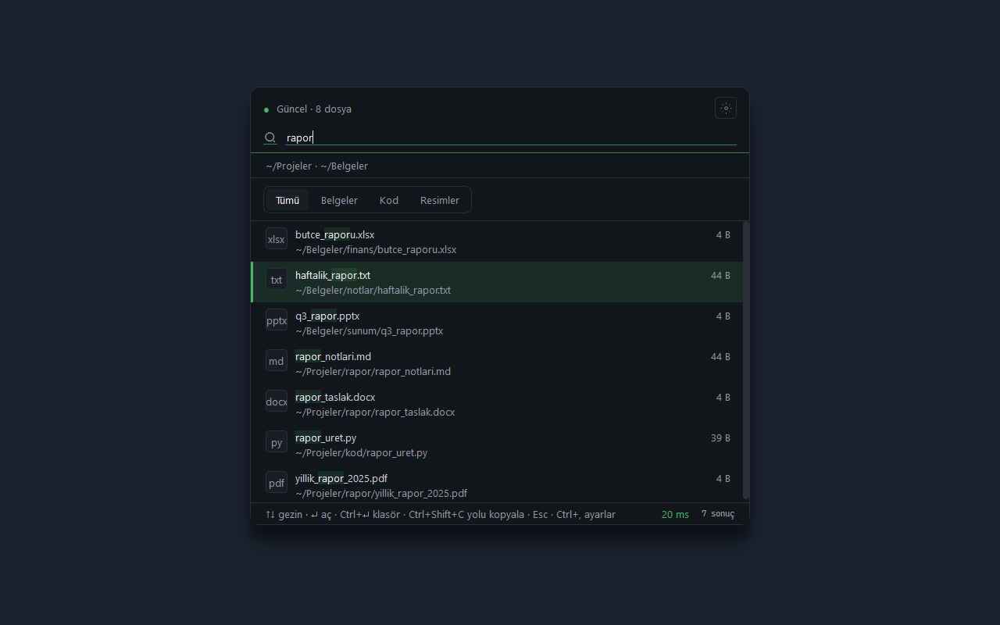

# Akıllı Dosya Arama Motoru

Windows'ta `Ctrl+Space` ile açılan, seçtiğiniz klasörlerde dosya adı ve içerik araması yapan Spotlight tarzı arama paleti. PySide6 ile yazılmıştır ve tamamen yerelde çalışır.



## Özellikler

- Dosya adında ve isteğe bağlı olarak metin/kod dosyalarının içeriğinde arama
- Yazım hatalarını tolere eden bulanık eşleşme (rapidfuzz), içerik eşleşmelerinde metin parçası
- `ext:py`, `kod`, `içerik` sorgu ekleri ve Tümü / Belgeler / Kod / Resimler filtreleri
- SQLite FTS5 indeksi (isteğe bağlı Tantivy), watchdog ile canlı güncelleme ve zamanlanmış gece indekslemesi
- İndeksi dışa ve içe aktarma
- Sonuçları açma, klasörde gösterme, yolu kopyalama; resimlerde küçük resim
- Son aramalar geçmişi
- İsteğe bağlı Everything köprüsü, sistem tepsisinde arka planda çalışma
- Koyu tema, görünür klavye odağı, ekran okuyucu adları

## Çalıştırma

```powershell
.\run.ps1          # kaynaktan çalıştır
.\run.ps1 -Check   # testler
.\run.ps1 -UiTest  # arayüz testleri (pytest-qt)
.\publish.ps1      # exe -> dist\akilli-dosya-arama-motoru\
```

Exe `--background` ile yalnızca tepside başlar. İlk kullanımda `Ctrl+,` ile klasör ekleyip **Yeniden indeksle**'ye basın.

## Kullanım

| Kısayol | İşlev |
|---|---|
| `Ctrl+Space` | Paleti aç / kapat (genel) |
| `↑` / `↓` | Sonuçlarda gezin (boş kutuda `↑`: son arama) |
| `Enter` | Dosyayı aç |
| `Ctrl+Enter` | Klasörde göster |
| `Ctrl+Shift+C` | Tam yolu kopyala |
| `Ctrl+1` … `Ctrl+4` | Filtre: Tümü / Belgeler / Kod / Resimler |
| `Esc` | Metni temizle, boşsa kapat |
| `Ctrl+,` | İndeks ayarları |

## Veri

Ayarlar, indeks ve arama geçmişi `%USERPROFILE%\.akilli-dosya-arama\` altında tutulur (`AKILLI_ARAMA_DATA_DIR` ile değiştirilebilir). Ağ erişimi yoktur; Everything köprüsü yalnızca yerel Everything sürecine bağlanır.
