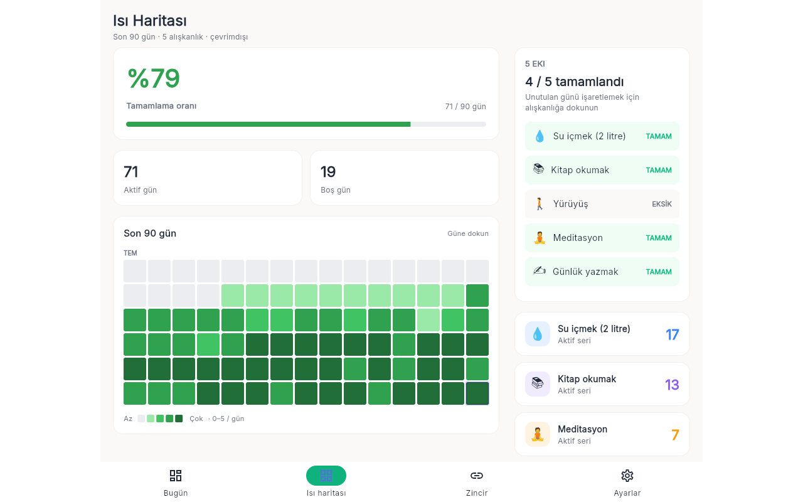

# Alışkanlık Takipçisi

Günlük ve haftalık alışkanlıkları seri (streak) ve ısı haritasıyla takip eden, tamamen yerel çalışan Flutter uygulaması.



## Özellikler

- Tek dokunuşla günlük check-in, günlük/haftalık seri sayacı
- Esnek seri: haftada 3 ile 7 gün arası hedef
- Son 90 günün ısı haritası, tamamlanma oranı ve geçmiş günde check-in ekleme/kaldırma
- Zincir alışkanlıklar: biri bitince sıradakini hatırlatır
- Alışkanlık başına ad, emoji ikon, renk, sıklık ve tetikleyici alışkanlık
- Günlük hatırlatıcı, Pazar haftalık rapor bildirimi (Android/iOS/macOS) ve Android ana ekran widget'ı
- Açık, koyu, sistem ve AMOLED tema
- JSON/CSV dışa aktarma ve JSON yedeğini panodan doğrulayarak geri yükleme
- Seri hesabı yerel takvim günlerine dayanır, yaz saati ve saat dilimi değişikliğinden etkilenmez

## Çalıştırma

```powershell
.\run.ps1          # kaynaktan çalıştır (Windows > Chrome > Edge sırasıyla ilk uygun cihaz)
.\run.ps1 chrome   # cihazı elle seç
.\run.ps1 -Check   # flutter analyze + flutter test
.\publish.ps1      # exe -> dist\aliskanlik-takipcisi\
```

Gereksinim: Flutter SDK 3.x. Windows exe ve Windows masaüstü hedefi için Geliştirici Modu açık olmalıdır (`start ms-settings:developers`); kapalıyken `run.ps1` Chrome/Edge'e geçer.

## Kullanım

| Ekran | Ne yapılır |
|-------|-----------|
| Bugün | Karta dokunarak check-in; `+` ile yeni alışkanlık; uzun basınca düzenle/sil |
| Isı haritası | Son 90 gün; güne dokunup o günün alışkanlıklarını işaretle/kaldır |
| Zincir | Tetikleyici ilişkisi tanımlı alışkanlıkların sıralı görünümü |
| Ayarlar | Tema, hatırlatıcılar, rapor, JSON/CSV dışa aktarma, JSON içe aktarma |

## Veri

Tüm veri cihazda `SharedPreferences` içinde tutulur (Windows'ta AppData, web'de `localStorage`). Hesap ve telemetri yoktur; tek ağ erişimi `google_fonts` paketinin Inter yazı tipini indirmesidir.
