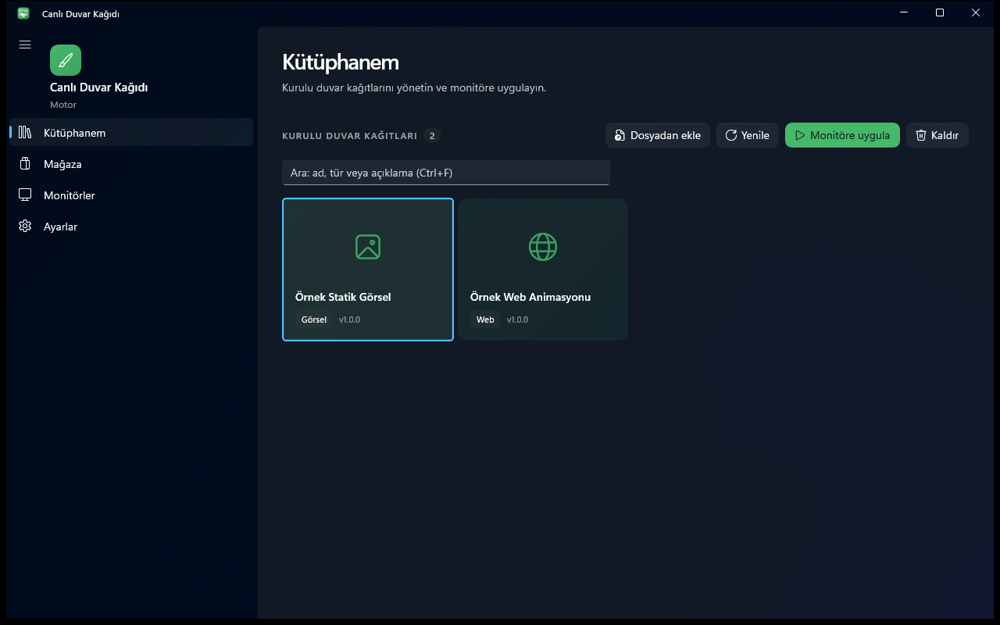

# Canlı Duvar Kağıdı Motoru

Windows 10/11 masaüstünde simgelerin arkasına görsel, video veya web (HTML/JS) duvar kağıdı yerleştiren WinUI 3 uygulaması.



## Özellikler

- Görsel (png/jpg/bmp/gif), video (mp4/webm) ve web (HTML/CSS/JS) duvar kağıtları; video ve web WebView2 ile oynatılır
- Dosyadan ekleme ya da kütüphaneye sürükle-bırak
- Kütüphanede ad, açıklama veya türe göre arama
- Her monitöre ayrı duvar kağıdı; atamalar açılışta geri yüklenir
- Tek tuşla tümünü duraklatma, tam ekran pencere öndeyken otomatik duraklatma
- Explorer yeniden başlarsa masaüstüne otomatik yeniden bağlanma
- Yerel katalog ya da HTTP(S) üzerinden self-host JSON katalog içeren mağaza
- Sistem tepsisi, Windows ile başlatma, koyu tema, klavye kısayolları

## Çalıştırma

```powershell
.\run.ps1          # kaynaktan çalıştır
.\run.ps1 -Check   # testler
.\run.ps1 -UiTest  # arayüz testleri (pencere açar)
.\publish.ps1      # exe -> dist\canli-duvar-kagidi-motoru\
```

Gereksinim: Windows 10 1809+ / Windows 11, kaynaktan derlemek için .NET 10 SDK ve [WebView2 Runtime](https://developer.microsoft.com/microsoft-edge/webview2/) (Windows 11'de hazır). Geliştirici Modu gerekmez.

## Kullanım

| Kısayol | İşlev |
|---|---|
| Ctrl+1 / 2 / 3 / 4 | Kütüphanem / Mağaza / Monitörler / Ayarlar |
| Ctrl+F | Kütüphanede ara |
| Ctrl+O | Dosyadan ekle |
| Ctrl+P | Tüm duvar kağıtlarını duraklat / devam ettir |
| F5 | Yenile (Mağaza'da katalogu yeniden yükler) |
| Ctrl+S | Ayarları kaydet (Ayarlar sayfasında) |
| Enter / çift tık | Seçili kartı uygula (Mağaza'da: indir ve kur) |
| Delete | Seçili kartı kaldır (onay sorar) |

## Veri

Kurulu paketler, önbellek ve `settings.json` `%AppData%\CanliDuvarKagidi\` altında tutulur (`CANLI_DUVAR_DATA` ile değiştirilebilir). Ağ erişimi yalnızca Ayarlar'da HTTP(S) katalog adresi girildiğinde yapılır; telemetri yoktur. Web duvar kağıtlarını yalnızca güvendiğiniz kataloglardan kurun.
