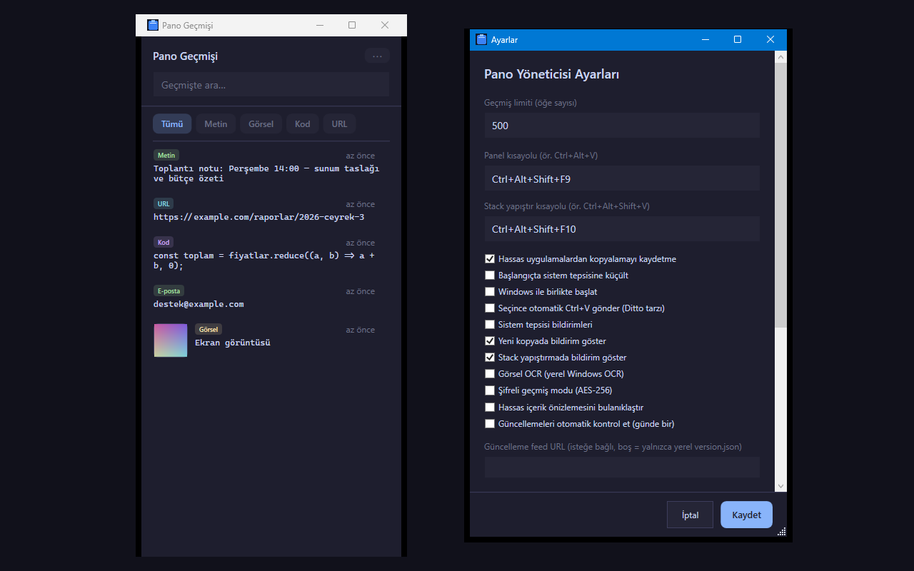

# Pano Geçmişi Yöneticisi

Kopyaladığınız metin, bağlantı, kod, görsel ve dosya yollarını yerel SQLite'a kaydeden, global kısayolla açılan bir sistem tepsisi aracı. WPF (.NET 10) ile yazılmıştır.



## Özellikler

- Panoyu otomatik dinler (metin, HTML, görsel, dosya listesi); aynı içerik tekrar kaydedilmez, en üste çıkar
- Tam metin (FTS5) arama ve Tümü / Metin / Görsel / Kod / URL filtreleri
- Sabitlenmiş öğeler listenin en üstünde
- Enter veya çift tıkla panoya alma, isteğe bağlı otomatik Ctrl+V
- Sağ tık dönüşümleri (küçük harf, boşluk, JSON, Markdown link, satır sonları) ve görsellerde yerel Windows OCR
- Stack yapıştırma: seçili öğeleri kuyruğa alıp global kısayolla sırayla yapıştırma
- Toplu silme ve `Ctrl+Z` ile son silmeyi geri alma
- Hassas uygulama listesi, regex filtresi, önizleme bulanıklaştırma, AES-256 şifreli mod ve oturum kilidi
- JSON dışa/içe aktarma

## Çalıştırma

```powershell
.\run.ps1          # kaynaktan çalıştır
.\run.ps1 -Check   # testler
.\run.ps1 -UiTest  # arayüz testleri (pencere açar)
.\publish.ps1      # exe -> dist\clipboard-gecmisi-yoneticisi\
```

Yerel kurulum ve kısayollar için `.\install.ps1` / `.\uninstall.ps1` kullanılır.

## Kullanım

| Kısayol | İşlev |
|---|---|
| Ctrl+Alt+V (global) | Paneli aç |
| Ctrl+Alt+Shift+V (global) | Stack'ten sıradakini yapıştır |
| Enter / çift tık | Seçili öğeyi panoya al |
| Ctrl+F | Aramaya odaklan |
| Delete | Seçili öğe(ler)i sil |
| Ctrl+Z | Son silmeyi geri al |
| Ctrl+P | Sabitle / sabitlemeyi kaldır |
| Esc | Paneli gizle |

Global kısayollar Ayarlar'dan değiştirilebilir.

## Veri

Veriler yalnızca `%LocalAppData%\ClipboardGecmisiYoneticisi\` altında tutulur (`CLIPBOARD_GECMISI_DATA_DIR` ile değiştirilebilir). Varsayılan olarak ağ erişimi yoktur; yalnızca Ayarlar'da güncelleme feed URL'si girilirse o adres okunur.
