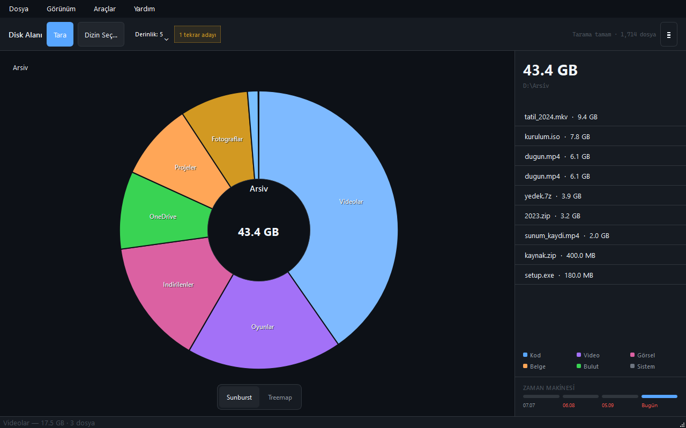

# Disk Alanı Görselleştirici

Disk kullanımını sunburst ve treemap grafikleriyle gösterip büyük dosyaları ve temizlenebilir klasörleri bulan PySide6 masaüstü uygulaması.



## Özellikler

- Sürücü veya klasör tarama; Hızlı / Normal / Tam derinlik, SQLite önbellek ve iptal
- Sunburst ve treemap grafikleri; tıklayarak alt klasöre inme, yol çubuğu
- 100 MB üzeri dosyalar ve temizlik önerileri (`node_modules`, önbellekler, geçici dosyalar)
- Zaman makinesi: aynı klasörün son 4 taraması arasındaki büyüme/küçülme
- Aynı boyutlu dosya grupları ve Tekrarlanan Dosya Bulucu'ya aktarım
- PNG, SVG, JSON, CSV ve HTML olarak dışa aktarma
- Zamanlanmış tarama ve tepsi bildirimi
- Onaylı silme; dosyalar Geri Dönüşüm Kutusu'na taşınır
- Koyu tema, ekran okuyucu adları, tüm işlevler klavyeyle

## Çalıştırma

```powershell
.\run.ps1          # kaynaktan çalıştır
.\run.ps1 -Check   # testler
.\run.ps1 -UiTest  # arayüz testleri (pytest-qt)
.\publish.ps1      # exe -> dist\disk-alan-gorsellestirici\
```

Exe `_internal` klasörüyle birlikte taşınmalıdır. Kurulum ve kaldırma için `.\install.ps1` / `.\uninstall.ps1` kullanılır.

## Kullanım

| Kısayol | İşlev |
|---|---|
| `Ctrl+O` | Dizin seç |
| `F5` / `Shift+F5` | Tara / önbelleği atlayarak tara |
| `Esc` | Taramayı iptal et; tarama yoksa köke dön |
| `Ctrl+1` / `Ctrl+2` | Sunburst / Treemap |
| `←` `→` `↑` `↓` · `Enter` (grafikte) | Dilim seç · içine gir |
| `Backspace` / `Alt+Home` | Üst klasör / köke dön |
| `Delete` (grafik / büyük dosyalar) | Çöpe taşı (onaylı) |
| `Ctrl+E` | Dışa aktar |

## Veri

Ayarlar ve tarama önbelleği `%LOCALAPPDATA%\DiskAlanGorsellestirici\` altında tutulur. Ağ erişimi ve telemetri yoktur.
