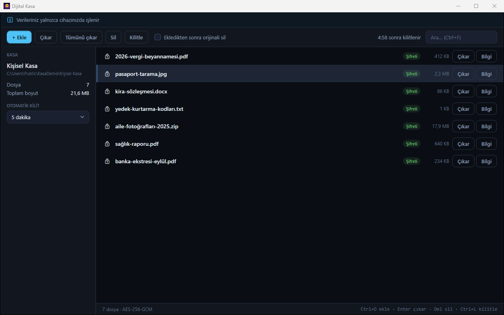

# Dosya Şifreleme ve Dijital Kasa

Dosyaları parola korumalı, yerel bir klasörde AES-256-GCM ile şifreleyerek saklayan Windows kasası. WPF (.NET 10) ile yazılmıştır.



## Özellikler

- Paroladan anahtar türetme Argon2id ile yapılır; parola ve anahtar diske yazılmaz
- İçerik, dosya adı ve uzantı AES-256-GCM ile şifrelenir
- Eklenen her dosya geri okunup orijinalle karşılaştırılır; doğrulanmayan kopya kasaya alınmaz
- Sürükle-bırak veya `Ctrl+O` ile ekleme; şifreleme arka planda yapılır
- İsteğe bağlı kasaya taşıma: orijinal, doğrulamadan sonra sıfırlarla üzerine yazılıp silinir
- Tek dosya ya da tüm kasayı bir klasöre çıkarma
- `Ctrl+L` ile kilit ve ayarlanabilir otomatik kilit (1/5/15/30 dk)
- Türkçe harf duyarsız arama, koyu tema, klavye ile tam kullanım

## Çalıştırma

```powershell
.\run.ps1          # kaynaktan çalıştır
.\run.ps1 -Check   # testler
.\run.ps1 -UiTest  # arayüz testleri (pencere açar)
.\publish.ps1      # exe -> dist\dosya-sifreleme-ve-dijital-kasa\
```

Kaynaktan derlemek için .NET 10 SDK gerekir; yayınlanan exe kurulum ya da .NET istemez.

## Kullanım

1. Kasa klasörünü seçin, en az 6 karakterlik bir parola girin (12+ önerilir) ve **Kasayı Oluştur ve Aç**'a basın.
2. Dosyaları sürükleyin ya da `+ Ekle` ile seçin. Orijinalin silinmesini istiyorsanız önce "Ekledikten sonra orijinali sil" kutusunu işaretleyin.
3. Geri almak için dosyayı seçip **Çıkar** (ya da `Enter`) deyin; tüm kasa için **Tümünü çıkar**.
4. İşiniz bitince **Kilitle** (`Ctrl+L`).

## Veri

Şifreli dosyalar seçtiğiniz kasa klasöründe (`vault.db` ve `data\`), tercihler `%LOCALAPPDATA%\DosyaSifreleme\settings.json` içinde tutulur; tercihlerde parola ya da anahtar bulunmaz. Ağ erişimi yoktur. Parola unutulursa kasa kurtarılamaz.
