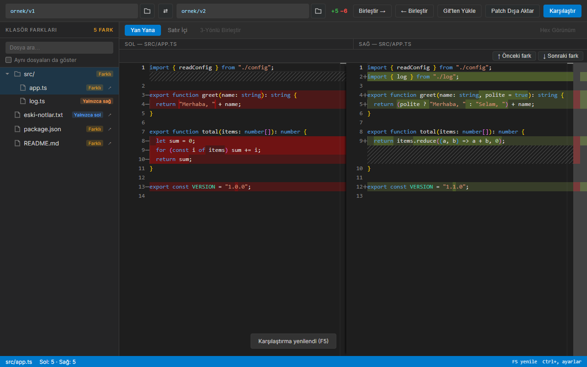

# Dosya ve Klasör Karşılaştırıcı

İki dosyayı veya klasörü yan yana karşılaştıran, farkları birleştiren ve patch üreten yerel bir Windows uygulaması (Meld / WinMerge alternatifi). Electron, React ve Monaco üzerine kuruludur.



## Özellikler

- Monaco ile yan yana veya satır içi metin diff, sözdizimi renklendirme
- Önceki/sonraki farka atlama (Alt+↑ / Alt+↓)
- Klasör karşılaştırma: hash önbelleği, `.gitignore` ve özel filtre desenleri, açılır klasör ağacı
- Tek yönlü kopyalama ile birleştirme; hedefin otomatik `.bak` yedeği alınır
- Base + sol + sağ ile basit 3 yönlü birleştirme
- Binary dosyalar için hex görünüm
- Unified patch dışa aktarma ve `git diff` çıktısını içe aktarma
- Sürükle-bırak, son karşılaştırılan çiftler, koyu/açık tema

## Çalıştırma

```powershell
.\run.ps1          # kaynaktan çalıştır
.\run.ps1 -Check   # tip kontrolü, birim testleri, derleme
.\run.ps1 -UiTest  # arayüz testleri (pencere açar)
.\publish.ps1      # exe -> dist\dosya-ve-klasor-karsilastirici\
```

Kaynaktan çalıştırmak için Node.js 22.12+ gerekir; `run.ps1` gerekirse `npm install` yapar ve Vite'ı **5171** portunda açar. Yayınlanan exe Node/Electron istemez.

## Kullanım

1. Sol ve sağ yolu yazın, klasör ikonuyla seçin ya da karşılama ekranına sürükleyin.
2. **Karşılaştır**'a basın (F5 veya yol kutusunda Enter). İki dosya doğrudan diff, iki klasör fark ağacı açar.
3. Ağaçta dosyaya tıklayıp **Birleştir →** / **← Birleştir** ile kopyalayın.
4. 3 yönlü birleştirme için Ayarlar > Diff > **Base yolu** girin ve **3-Yönlü Birleştir** sekmesini kullanın.
5. **Patch Dışa Aktar** ile `.patch` yazın; **Git'ten Yükle** ile `git diff` çıktısını görüntüleyin.

## Veri

Ayarlar, son çiftler ve hash önbelleği `%LocalAppData%\DosyaKarsilastirici\` altında tutulur. Ağ erişimi yoktur; Monaco yerel paketten yüklenir.
