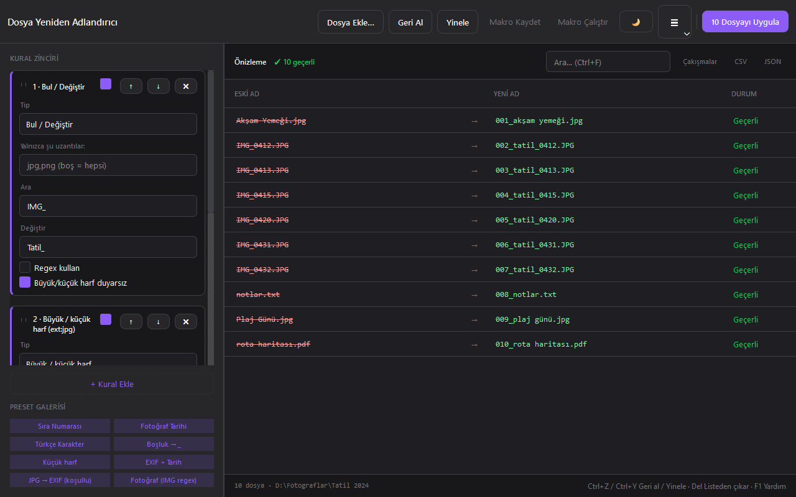

# Dosya Yeniden Adlandırıcı

Dosyaları kural zinciri ve canlı önizlemeyle toplu olarak yeniden adlandıran PySide6 masaüstü uygulaması. Yapılan adlandırmalar geri alınabilir.



## Özellikler

- Bul/değiştir (düz metin veya regex), numaralandırma, büyük/küçük harf, uzantı değiştirme ve EXIF ya da değiştirme tarihi kuralları
- Her kurala uzantı koşulu; kuralları sıralama ve devre dışı bırakma
- 8 hazır kural seti, makro kaydetme ve kural setini JSON olarak kaydetme/yükleme
- Canlı önizleme: çakışan ve Windows'ta yasak adlar işaretlenir, bu durumda uygulama engellenir
- Önizlemede arama, yalnızca çakışmalar/değişenler filtresi, CSV ve JSON dışa aktarma
- Hiçbir dosyanın üzerine yazılmaz; işlem yarıda hata verirse tüm adımlar geri alınır
- Çok adımlı geri al (`Ctrl+Z`, uygulama yeniden açılınca da çalışır) ve yinele (`Ctrl+Y`)
- Sürükle-bırak, koyu/açık tema, tüm eylemler klavyeyle

## Çalıştırma

```powershell
.\run.ps1          # kaynaktan çalıştır
.\run.ps1 -Check   # testler
.\run.ps1 -UiTest  # arayüz testleri
.\publish.ps1      # exe -> dist\dosya-yeniden-adlandirici\
```

`run.ps1` gerekli `.venv` ortamını kendisi kurar.

## Kullanım

1. Dosyaları sürükleyin ya da `Ctrl+O` (dosya) / `Ctrl+Shift+O` (klasör) ile ekleyin.
2. Soldaki kural zincirini düzenleyin veya hazır bir set seçin; önizleme anında güncellenir.
3. Çakışma varsa "Çakışmalar" filtresiyle bulup düzeltin; listeden çıkarmak için `Delete`.
4. "N Dosyayı Uygula" veya `Ctrl+Enter` ile onaylayın. Sonuçtan memnun değilseniz `Ctrl+Z`.

## Veri

Ayarlar ve geri alma geçmişi `%USERPROFILE%\.local\share\DosyaYenidenAdlandirici\` altında (`settings.json`, `undo_history.json`) tutulur. Ağ erişimi ve telemetri yoktur.
