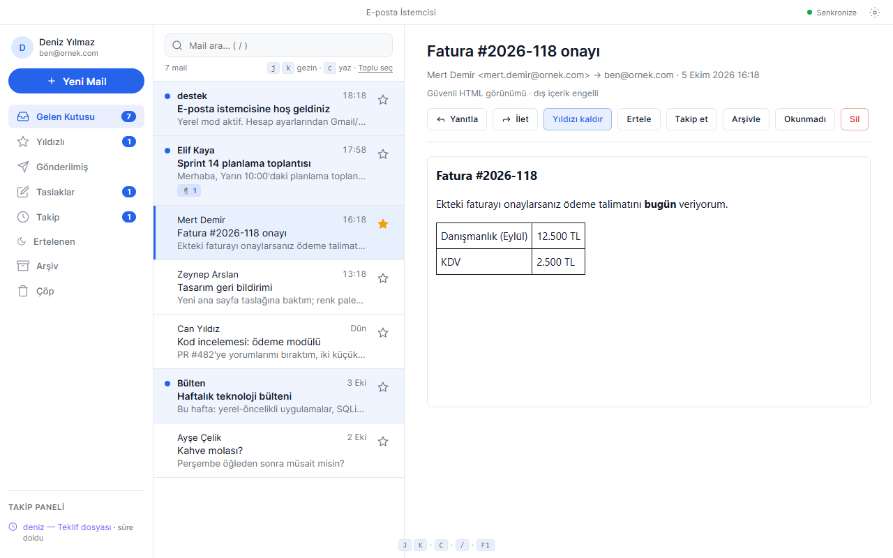

# E-posta İstemcisi ve Takip Aracı

IMAP/SMTP hesaplarını yerel SQLite önbelleğiyle yöneten Electron e-posta istemcisi. Yanıt takibi ve erteleme cihazda çalışır.



## Özellikler

- Birden çok IMAP/SMTP hesabı (Gmail/Outlook profili veya özel sunucu), Gmail için uygulama şifresi veya OAuth
- Birleşik gelen kutusu, gönderilmiş, taslaklar, yıldızlı, arşiv ve çöp; arama ve toplu işlemler
- HTML mailler korumalı iframe'de açılır, uzak görseller ve izleme pikselleri yüklenmez
- Yanıt takibi (3/5/7 gün): süre dolunca bildirim verir, aynı konulu yanıt gelince kendiliğinden kapanır
- Erteleme (bu akşam, yarın, gelecek hafta, özel tarih) ve Ertelenen klasörü
- Silme, arşivleme, erteleme ve toplu işlemler için geri al (`Ctrl+Z`)
- Şablonlar (`{ad}`, `{konu}`) ve gizli piksel kullanmayan okundu bildirimi
- Açık/koyu/sistem teması, JSON yedek dışa/içe aktarma, IMAP IDLE ve sistem tepsisi

## Çalıştırma

```powershell
.\run.ps1          # kaynaktan çalıştır
.\run.ps1 -Check   # testler
.\run.ps1 -UiTest  # arayüz testleri
.\publish.ps1      # exe -> dist\e-posta-istemcisi-ve-takip-araci\
```

Kaynaktan çalıştırmak için Node.js 22.12+ gerekir. `run.ps1` Vite sunucusunu 5172 portunda açar.

## Kullanım

İlk kurulum: Ayarlar, Gmail/Outlook profili, e-posta ve şifre (veya OAuth Client ID), Bağlantıyı test et, Kaydet, Senkronize.

| Kısayol | İşlev |
|---|---|
| `j` / `k` | Sonraki / önceki mail |
| `Enter` | Maili aç |
| `c` | Yeni mail |
| `r` / `f` | Yanıtla / İlet |
| `e` / `#` | Arşivle / Sil |
| `/` | Aramaya odaklan |
| `F1` | Kısayol yardımı |

## Veri

Önbellek, ayarlar ve hesaplar `%APPDATA%\e-posta-istemcisi-ve-takip-araci\` altında tutulur; şifre ve OAuth token'ları Windows DPAPI ile şifrelenir. Ağ erişimi yalnızca yapılandırdığınız IMAP/SMTP sunucularına ve seçerseniz Google OAuth'a yapılır.
