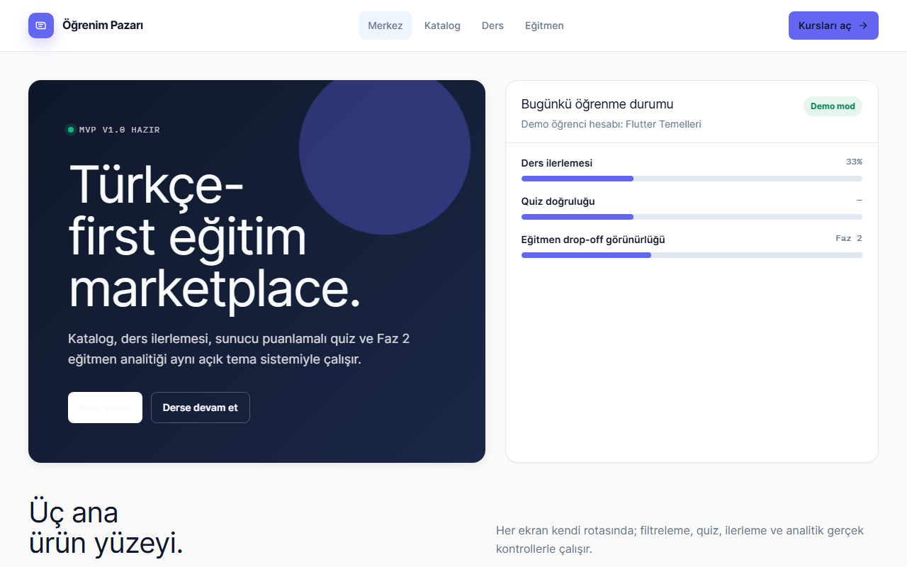

# Öğrenim Pazarı

Kurs kataloğu, ders ilerlemesi ve sunucuda puanlanan quiz içeren, yerelde çalışan Next.js + SQLite eğitim platformu. Kimlik doğrulama, ödeme ve gerçek video oynatıcı yoktur.



## Özellikler

- Katalogda arama (Türkçe harf duyarsız), seviye ve kategori filtresi
- Kurs sayfasında müfredat kenar çubuğu, ders tamamlama ve ilerleme yüzdesi
- İlerlemeyi sıfırlama (quiz geçmişi korunur)
- Tüm dersler bitince açılan quiz; doğru cevaplar istemciye gönderilmez, puanlama sunucuda yapılır
- Quiz geçmişi: son 5 deneme ve en iyi sonuç
- Eğitmen paneli prototipi: drop-off grafiği, taslağa modül ekleme, yayın kontrol listesi (veri kaydetmez)
- İlk açılışta otomatik oluşturulan demo kurs (Flutter Temelleri: 3 ders, 3 soru)

## Çalıştırma

```powershell
.\run.ps1          # kaynaktan çalıştır
.\run.ps1 -Check   # testler
.\publish.ps1      # exe -> dist\egitim-ve-ogrenme-platformu\
```

`run.ps1` uygulamayı http://localhost:3101 adresinde açar. Kaynaktan çalıştırmak için Node.js 22.5+ gerekir; exe için gerekmez.

## Kullanım

1. Merkez'den Kurs vitrini'ne geçin, kursu arayın veya filtreleyin, Devam et ile açın.
2. Dersi seçip Dersi tamamla'ya basın; üç ders bitince Quiz'e geç.
3. Tüm soruları yanıtlayıp Cevabı gönder; sonuç ve geçmiş altta görünür.
4. Baştan almak için kenar çubuğunda İlerlemeyi sıfırla (onay ister).

## Veri

Veriler yerel SQLite'ta tutulur: kaynaktan çalışırken `prisma\dev.db`, exe'de `%APPDATA%\Ogrenim Pazari\ogrenim.db`. Ağ erişimi ve telemetri yoktur, tüm istekler yerel sunucuya gider.
