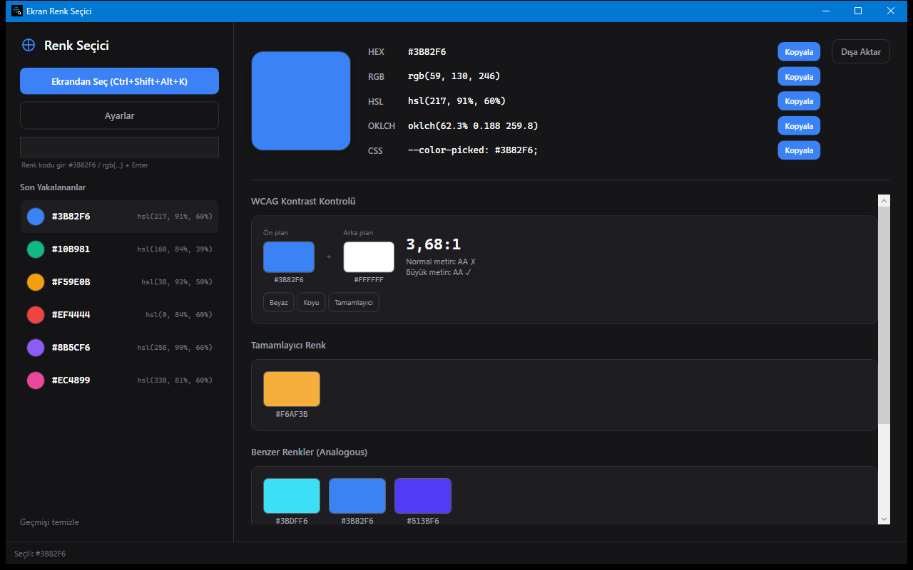

# Ekran Renk Seçici

Ekrandaki herhangi bir pikselin rengini global kısayol ve büyüteçle yakalayıp panoya kopyalayan WPF tepsi uygulaması.



## Özellikler

- Global kısayolla (varsayılan `Ctrl+Shift+C`) açılan tam ekran seçim katmanı ve büyüteç; çoklu monitör ve DPI uyumlu
- 1×1, 3×3 veya 5×5 piksel ortalama
- HEX, RGB, HSL, OKLCH ve CSS değişkeni formatları, her biri tek tıkla kopyalanır
- WCAG kontrast oranı, tamamlayıcı ve analog palet
- Renk körlüğü simülasyonu (protan, deutan, tritan)
- Ekrandan seçmeden renk kodu girişi (`#3B82F6`, `#38F`, `rgb(59, 130, 246)`)
- Son 10 rengin geçmişi, yeniden başlatmada korunur
- Tailwind, Figma ve CSS token olarak dışa aktarma
- Tepsi simgesi; pencereyi kapatmak uygulamayı tepsiye gizler

## Çalıştırma

```powershell
.\run.ps1          # kaynaktan çalıştır
.\run.ps1 -Check   # testler
.\run.ps1 -UiTest  # arayüz testleri
.\publish.ps1      # exe -> dist\ekran-renk-secici\
```

Yayınlanan exe tek dosyadır, .NET gerektirmez.

## Kullanım

Kısayola basın, imleci hedefe götürün, tıklayın veya Enter'a basın. Renk seçili formatta panoya kopyalanır ve geçmişe eklenir.

| Kısayol | İşlev |
|---|---|
| `Ctrl+Shift+C` (ayarlanabilir) | Seçim katmanını aç |
| Tık / `Enter` | Rengi kopyala ve kapat |
| `Esc` | İptal |
| `Tab` / `Shift+Tab`, `←` `→` | Format değiştir |
| `Space` | Büyüteç ızgarası |
| `1` / `3` / `5` | Örnekleme boyutu |

## Veri

Ayarlar `%AppData%\EkranRenkSecici\settings.json`, geçmiş `history.json` dosyasında tutulur. Ağ erişimi yoktur; ekran görüntüsü yalnızca seçim katmanı açıkken bellekte alınır, diske yazılmaz.
