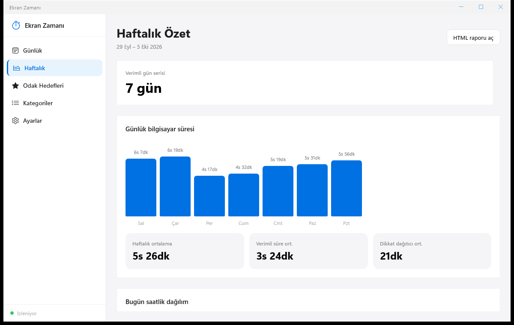

# Ekran Zamanı

Hangi uygulamada ne kadar vakit geçirdiğinizi ölçen, kategorilere ayıran ve verileri yerelde saklayan WinUI 3 uygulaması.



## Özellikler

- Ön plandaki uygulamayı saniyede bir izler ve boşta kalmayı algılar (eşik ayarlanabilir)
- Kilit ekranı ve uyku süresi sayılmaz; gece yarısını aşan kayıtlar günlere bölünür
- Günlük özet: zaman çizelgesi, en çok kullanılan uygulamalar, kategori dağılımı, web siteleri
- Haftalık özet: günlük süre grafiği, ortalamalar, verimli gün serisi, saatlik dağılım, HTML rapor
- Kural tabanlı kategoriler (Verimli, İletişim, Nötr, Dikkat dağıtıcı) ve son 7 güne göre kural önerileri
- Odak hedefleri, dikkat dağıtıcı süre uyarısı ve günlük özet bildirimi
- Gizlenecek uygulama listesi; parola yöneticileri varsayılan olarak kaydedilmez
- CSV/JSON dışa aktarma, ActivityWatch içe/dışa aktarma, zip yedekleme ve geri yükleme
- İsteğe bağlı tarayıcı eklentisiyle site bazlı süre

## Çalıştırma

```powershell
.\run.ps1          # kaynaktan çalıştır
.\run.ps1 -Check   # testler
.\publish.ps1      # exe -> dist\ekran-zamani-ve-uygulama-kullanim-takibi\
```

Windows 10/11 x64 gerekir; kaynaktan derlemek için .NET 10 SDK. Geliştirici Modu gerekmez.
Pencereyi kapatınca uygulama tepside çalışmaya devam eder; çıkmak için tepsi menüsünden Çıkış. Global kısayol `Ctrl+Shift+E`.
Tarayıcı eklentisi: Chrome/Edge'de `chrome://extensions` sayfasında Geliştirici modunu açın, Paketlenmemiş öğe yükle ile `browser-extension` klasörünü seçin.

## Veri

Tüm veriler bu bilgisayarda, `%LocalAppData%\EkranZamani\` altında (`usage.db`, `settings.json`) tutulur. Telemetri yoktur; tarayıcı eklentisi için açılan yerel köprü yalnızca `127.0.0.1:47123` adresini dinler, dışarıya tek çıkış yapılandırırsanız haftalık e-posta raporudur (SMTP).
