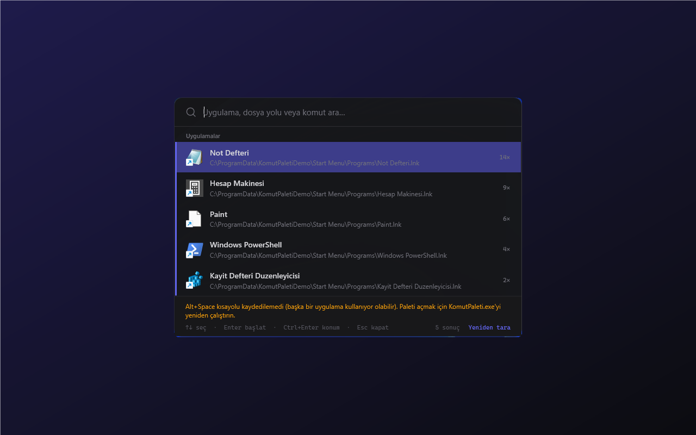

# Komut Paleti

Alt+Space ile açılan, uygulama, dosya/klasör yolu, PowerShell komutu ve web aramasını tek kutudan başlatan WPF komut paleti.



## Özellikler

- Başlat Menüsü kısayollarını (.lnk/.url) SQLite'a indeksler, en çok açılanları üstte gösterir
- Kaldırılan uygulamalar her taramada listeden düşer, kullanım sayıları korunur
- `C:\Windows`, `%TEMP%` gibi var olan yolları doğrudan açar
- `>` ile başlayan sorguyu PowerShell'de çalıştırır (`> git status`)
- Yerel sonuç yoksa Google'da arar
- Görev çubuğunda görünmez ve tek örnek çalışır; exe yeniden çalıştırılınca açık örneğin paleti görünür

## Çalıştırma

```powershell
.\run.ps1          # kaynaktan çalıştır
.\run.ps1 -Check   # testler
.\run.ps1 -UiTest  # arayüz testleri
.\publish.ps1      # exe -> dist\evrensel-uygulama-ve-dosya-baslatici\
```

Alt+Space başka bir uygulamada (ör. PowerToys Run) kayıtlıysa palet açılışta bir uyarı gösterir.

## Kullanım

| Kısayol | İşlev |
|---|---|
| `Alt+Space` | Paleti aç / kapat |
| `↑` `↓` | Sonuçlar arasında gezin |
| `Enter` | Seçileni başlat (sonuç yoksa web araması) |
| `Ctrl+Enter` | Dosya konumunu Gezgin'de göster |
| `Esc` | Paleti gizle |
| `Alt+F4` | Uygulamadan çık |

## Veri

Veritabanı `%LOCALAPPDATA%\KomutPaleti\launcher.db` dosyasındadır. Ağ erişimi yoktur; "Google'da ara" yalnızca varsayılan tarayıcıyı açar.
