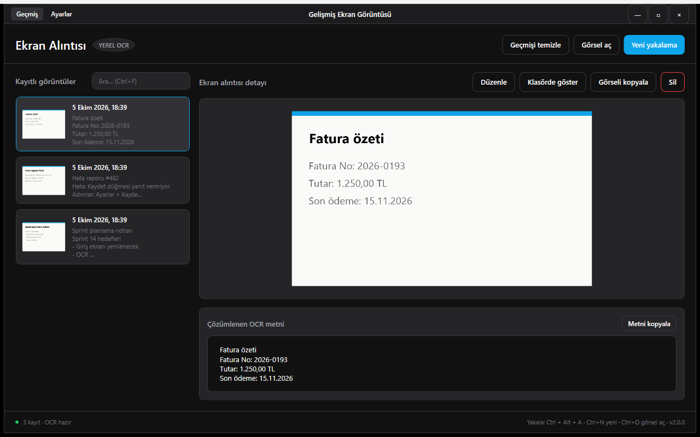

# Gelişmiş Ekran Görüntüsü ve Not Alma

Ekran yakalama, görüntü üzerine işaret ekleme ve çevrimdışı OCR yapan WPF Windows uygulaması.



## Özellikler

- Global kısayolla (varsayılan `Ctrl+Alt+A`) bölge veya tam ekran yakalama; tüm monitörler ve yüksek DPI
- Var olan PNG/JPG/BMP/GIF/TIFF dosyasını düzenleyicide açma
- Ok, dikdörtgen, kalem, metin ve pikselleştirme araçları, geri al
- Cihazda çalışan OCR ve metni kopyalama
- PNG olarak kaydetme veya panoya kopyalama; kaydedilen görüntü geçmişe eklenir
- OCR metni ve dosya adına göre aranabilen geçmiş
- Geçmişteki bir kaydı yeniden düzenleme (yeni kayıt olarak saklanır)
- Ayarlanabilir geçmiş sınırı (20/50/100/500), kayıt klasörü ve dosya adı şablonu

## Çalıştırma

```powershell
.\run.ps1          # kaynaktan çalıştır
.\run.ps1 -Check   # testler
.\run.ps1 -UiTest  # arayüz testleri
.\publish.ps1      # exe -> dist\gelismis-ekran-goruntusu-ve-not-alma-araci\
```

Kaynaktan derlemek için Windows 10 (19041) veya 11 ve .NET 10 SDK gerekir. OCR için Windows'ta yüklü bir dil paketi gerekir.

## Kullanım

| Kısayol | Eylem |
|---|---|
| `Ctrl+Alt+A` (ayarlanabilir, global) | Yakala |
| `Ctrl+N` / `Ctrl+O` / `Ctrl+,` | Yeni yakalama / Görsel aç / Ayarlar |
| `Ctrl+F`, `Esc` | Ara / aramayı temizle |
| `Enter`, `Delete` (geçmişte) | Düzenle / Sil |
| `Enter`, `Esc`, sağ tık (yakalamada) | Onayla / iptal |
| `1`-`5`, `Ctrl+Z`, `Ctrl+S`, `Ctrl+C`, `Esc` (düzenleyicide) | Araç / geri al / kaydet / kopyala / kapat |

## Veri

Geçmiş (`screenshots.db`), ayarlar ve varsayılan `screenshots\` klasörü `%LOCALAPPDATA%\GelismisEkranGoruntusu\` altındadır. Ağ erişimi yoktur; OCR Windows'un yerleşik `Windows.Media.Ocr` motoruyla cihazda yapılır.
