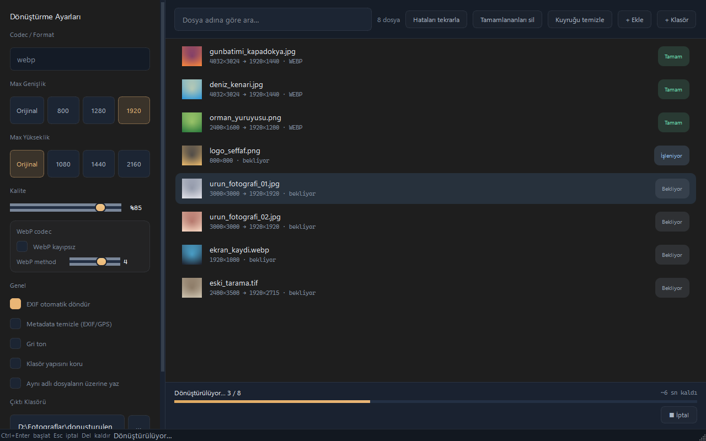

# Görsel Arama ve Toplu Dönüştürücü

Görselleri kuyruğa toplayıp tek seferde WebP, JPEG, PNG veya AVIF'e dönüştüren, küçülten ve metadata'sını temizleyen PySide6 masaüstü uygulaması.



## Özellikler

- Dosya ve klasör ekleme (alt klasörler dahil), sürükle-bırak
- Küçük resimli kuyruk, durum rozeti ve boyut önizlemesi (`4032×3024 → 1920×1440`)
- Dosya adına göre arama, hataları tekrarlama, tamamlananları silme
- Kalite ve max genişlik/yükseklik ön ayarları (yalnızca küçültür), codec ayarları
- EXIF yönüne göre döndürme, gri ton, klasör yapısını koruma
- "Metadata temizle" EXIF/GPS'i siler, renk profili (ICC) korunur
- Arka planda dönüştürme, ilerleme çubuğu ve kalan süre, `Esc` ile onaylı iptal
- Orijinaller ezilmez: aynı adlı çıktı varsa `ad (1).uzantı` üretilir

## Çalıştırma

```powershell
.\run.ps1          # kaynaktan çalıştır (ilk çalıştırmada .venv kurar)
.\run.ps1 -Check   # birim testleri
.\run.ps1 -UiTest  # arayüz testleri (pytest-qt)
.\publish.ps1      # exe -> dist\gorsel-arama-ve-toplu-donusturucu\
```

Gereksinim: Python 3.11+ (3.13 önerilir). HEIC girdisi için ek Pillow eklentisi gerekir, yoksa o dosyalar "Hata" olarak işaretlenir.

## Kullanım

1. Görselleri ekleyin (sürükle-bırak, `Ctrl+O` veya `Ctrl+Shift+O`).
2. Soldan format, boyut ve kaliteyi seçin.
3. Çıktı klasörünü "…" ile seçin (varsayılan `~/Pictures/converted`).
4. "N Dosyayı Dönüştür" veya `Ctrl+Enter` ile başlatın.

Diğer kısayollar: `Esc` iptal, `Del` seçili dosyayı kaldır, `Ctrl+F` arama.

## Veri

Ayarlar `%LOCALAPPDATA%\gorsel-arama-ve-toplu-donusturucu\settings.json` dosyasında tutulur. Uygulama yalnızca seçtiğiniz dosyaları okur ve seçtiğiniz çıktı klasörüne yazar; ağ erişimi ve telemetri yoktur.
