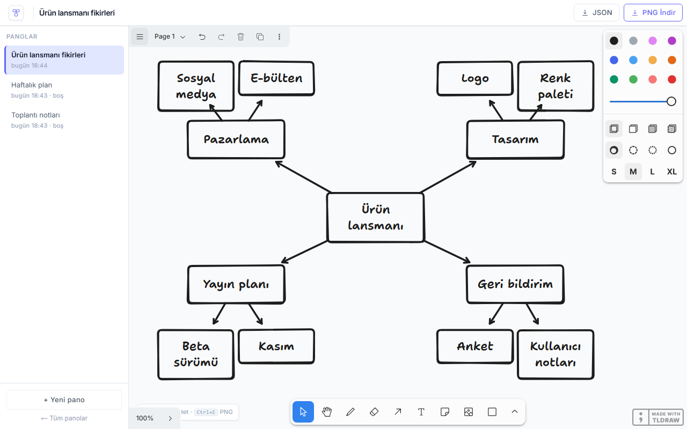

# Görsel Not ve Beyin Haritası

tldraw tuvali üzerinde pano oluşturup yerel SQLite'a otomatik kaydeden, çevrimdışı çalışan Next.js uygulaması.



## Özellikler

- Pano listesi: oluşturma, yeniden adlandırma, silme, adla arama
- tldraw tuvali: şekil, ok, metin, serbest çizim
- Değişiklikten 2 sn sonra otomatik kayıt, sayfa veya pencere kapanırken bekleyen kayıt hemen yazılır
- PNG dışa aktarma (2x ölçek, arka planlı)
- JSON yedek indirme ve içe aktarma (tldraw.com `.tldr` dosyaları dahil)
- Çevrimdışı çalışır, tldraw varlıkları uygulamayla gelir
- Okunamayan pano verisi salt okunur açılır, üzerine boş tuval yazılmaz
- İsteğe bağlı Electron masaüstü sürümü (hedef makinede Node gerekmez)

## Çalıştırma

```powershell
.\run.ps1          # gerekirse npm ci + prisma db push, ardından http://localhost:3102
.\run.ps1 -Check   # vitest + tip kontrolü + Playwright e2e
.\publish.ps1      # Electron paketi -> dist\gorsel-not-ve-beyin-haritasi-araci\
```

Gereksinim: Node.js 20+. Uygulama 3102 portunu kullanır; port doluysa `run.ps1` hiçbir süreci kapatmaz.

## Kullanım

| Kısayol | Nerede | İşlev |
| --- | --- | --- |
| `Ctrl+N` | Ana sayfa | Yeni pano |
| `Ctrl+S` | Pano | Bekleyen değişikliği hemen kaydet |
| `Ctrl+E` | Pano | PNG olarak dışa aktar |
| `Esc` | Pano | Yan pano listesini kapat (dar pencere) |

## Veri

Panolar yerel SQLite dosyasında tutulur: geliştirme sürümünde `prisma/dev.db`, masaüstü sürümünde `%APPDATA%\Gorsel Not\panolar.db`. Hesap ve telemetri yoktur, kod dışarıya istek göndermez. `npm run dev` / `npm start` tüm ağ arayüzlerini kimlik doğrulamasız dinler; masaüstü sürümü yalnızca `127.0.0.1` üzerinde dinler.
