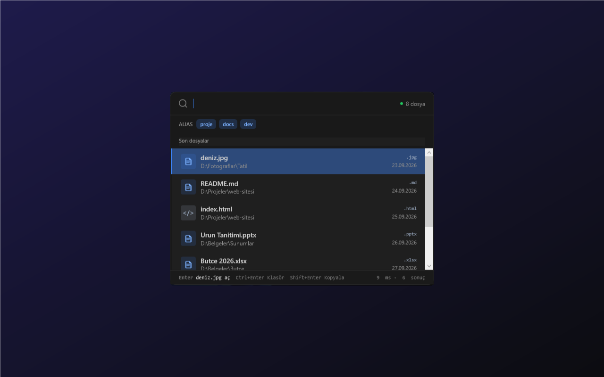

# Hızlı Dosya Arama

`Alt+F` ile açılan, dosya adlarını yerel SQLite indeksinde yazdıkça arayıp Enter ile açan klavye odaklı Windows (WPF) aracı.



## Özellikler

- Yazdıkça dosya adında arama (en fazla 50 sonuç)
- Çok kelime sırasız eşleşir (`rapor 2024`)
- Nokta ile başlayan kelime uzantı süzgecidir (`rapor .pdf`, `butce .xlsx .csv`)
- Boş aramada son açılan dosyalar listelenir
- `aliases.json` içindeki hazır sorgular palette çip olarak görünür
- Belgeler, Masaüstü, İndirilenler ve varsa `Desktop\DEV\projects` indekslenir
- Sistem tepsisinde çalışır (Aç / Yeniden indeksle / Çıkış), tek örnek

## Çalıştırma

```powershell
.\run.ps1          # Debug derle + başlat (-Release, -NoBuild)
.\run.ps1 -Check   # birim testleri + açılış duman testi
.\publish.ps1      # tek exe -> dist\hizli-dosya-arama-ve-acma-araci\
```

İndeks canlı izlenmez; yeni dosyalar için tepsiden "Yeniden indeksle" seçilir.

## Kullanım

| Kısayol | İşlev |
|---|---|
| Alt+F | Paleti aç |
| ↑ ↓ | Sonuçlar arasında gezin |
| Enter | Dosyayı aç |
| Ctrl+Enter | Gezgin'de göster |
| Shift+Enter | Yolu kopyala |
| Esc | Kapat (uygulama tepside kalır) |

## Veri

Veritabanı, `aliases.json` ve `crash.log` `%LOCALAPPDATA%\HizliDosyaArama\` altında tutulur (`HIZLI_DOSYA_ARAMA_DATA_DIR` ile değiştirilebilir). Yalnızca dosya adı, yol, boyut ve tarih indekslenir, içerik okunmaz. Ağ erişimi yoktur.
