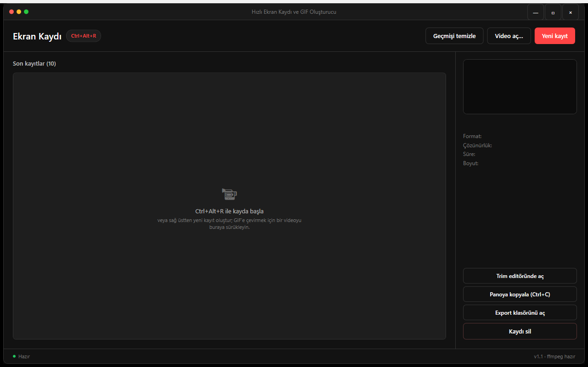

# Hızlı Ekran Kaydı ve GIF Oluşturucu

Ekranın bir bölgesini kaydedip kırpan ve GIF ya da MP4 olarak kaydeden Windows (WPF) uygulaması. Tüm işlem yerelde ffmpeg ile yapılır.



## Özellikler

- Sürükleyerek bölge seçme, taşıma ve boyutlandırma; çoklu monitörü kapsar
- 10 / 15 / 24 FPS, imleci gösterme veya gizleme
- Ctrl+Alt+R global kısayolu ile kayıt başlatma ve durdurma
- Kayıttan sonra timeline üzerinde kırpma, süre ve dosya boyutu tahmini
- GIF (iki geçişli palet) veya MP4 (H.264) olarak dışa aktarma
- Son 10 kaydın geçmişi, küçük resim ve detay paneli
- Var olan bir videoyu (MP4, MOV, MKV, AVI, WEBM, WMV) açıp GIF/MP4'e dönüştürme
- Seçili kaydı dosya olarak panoya kopyalama

## Çalıştırma

```powershell
.\run.ps1          # derle ve başlat (-Release, -NoBuild)
.\run.ps1 -Check   # testler
.\publish.ps1      # exe + ffmpeg\ -> dist\hizli-ekran-kaydi-ve-gif-olusturucu\
```

Gereksinim: Windows 10/11, geliştirme için .NET 10 SDK. ffmpeg bulunamazsa `winget install Gyan.FFmpeg` ile kurulur. Ses kaydedilmez.

## Kullanım

| Kısayol | Bağlam | İşlev |
|---|---|---|
| Ctrl+Alt+R | Global | Kayıt katmanını aç / kaydı başlat-durdur |
| Ctrl+O | Ana pencere | Video aç (dönüştürme için) |
| Ctrl+C | Ana pencere | Seçili kaydı dosya olarak panoya kopyala |
| Enter / R | Bölge seçimi | Kaydı başlat |
| Esc | Bölge seçimi | İptal |
| Boşluk | Kırpma penceresi | Oynat / duraklat |
| Ctrl+S | Kırpma penceresi | Dışa aktar |

## Veri

Kayıtlar, veritabanı ve küçük resimler `%LOCALAPPDATA%\EkranKaydi\` altında tutulur (`EKRANKAYDI_DATA_DIR` ile değiştirilebilir). Ağ erişimi ve telemetri yoktur.
