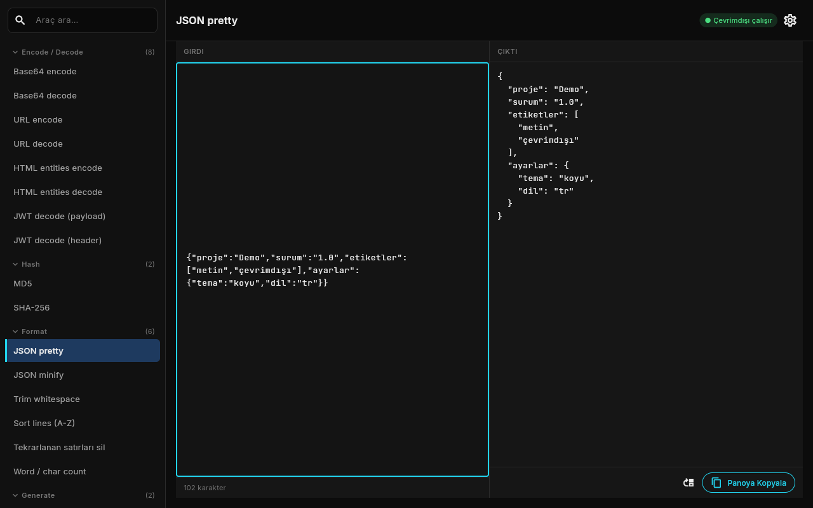

# Metin Dönüştürücü

29 yerel metin aracı (Base64, URL, JWT, hash, JSON, Türkçe büyük/küçük harf, slug...) sunan, internetsiz çalışan Flutter masaüstü uygulaması.



## Özellikler

- Base64, URL ve HTML entities encode/decode, JWT decode
- MD5 ve SHA-256 hash
- JSON pretty/minify, satır sıralama, tekrarlanan satırları silme, kelime/karakter sayımı
- UUID v4 ve rastgele metin üretme
- camelCase, snake_case, kebab-case ve slug dönüşümü
- Türkçe büyük/küçük harf ve Başlık Düzeni (i ↔ İ, ı ↔ I doğru eşlenir)
- Çıktıyı girdi yaparak dönüşümleri zincirleme
- Yazdıkça canlı dönüşüm ve aksansız araç arama
- JWT veya private key yapıştırılınca uyarı bandı

## Çalıştırma

```powershell
.\run.ps1          # Windows > Chrome > Edge sırasıyla ilk uygun cihaz
.\run.ps1 chrome   # cihazı elle seç
.\run.ps1 -Check   # flutter analyze + flutter test
.\publish.ps1      # exe -> dist\hizli-metin-manipulasyon-ve-donusturucu-araclar\
```

Windows exe ve Windows masaüstü hedefi için Geliştirici Modu açık olmalıdır: `start ms-settings:developers`. Mod kapalıyken `run.ps1` Chrome/Edge'e düşer.

## Kullanım

| Kısayol | İşlev |
|---------|-------|
| `Ctrl+Shift+C` | Çıktıyı kopyala |
| `Ctrl+L` | Girdiyi temizle |
| `Ctrl+F` | Araç aramasına odaklan |
| `Ctrl+Enter` | Dönüştür |
| `Ctrl+Shift+Enter` | Çıktıyı girdi yap |

## Veri

Dönüşümler cihazda yapılır, girdi ve çıktı diske yazılmaz. Yalnızca tema ve son kullanılan araç `SharedPreferences` ile saklanır. Tek ağ erişimi `google_fonts` paketinin Inter yazı tipini indirmesidir.
