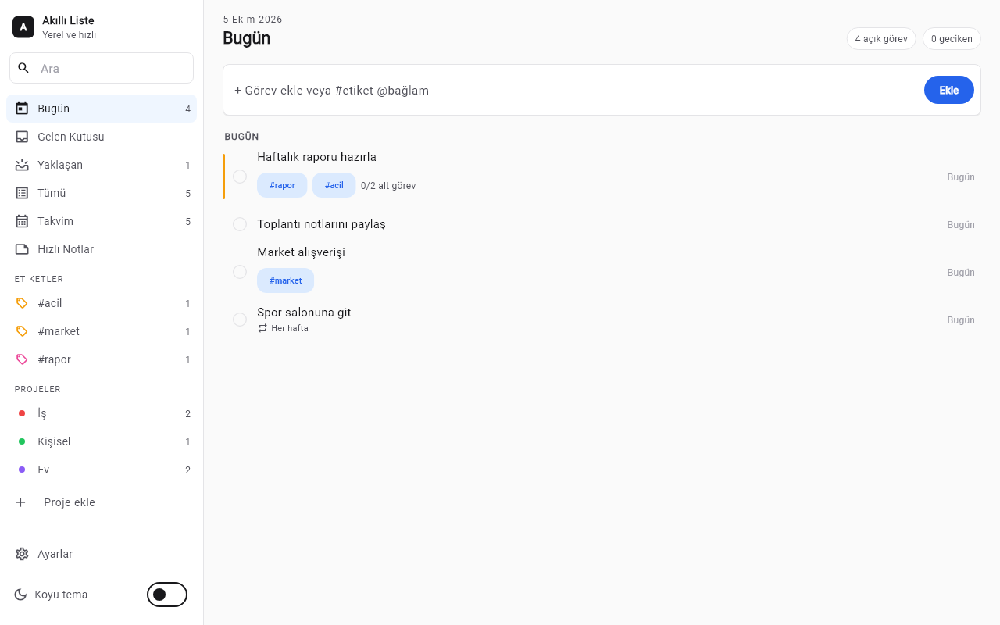

# Akıllı Liste (Hızlı Not ve Görev)

Görevleri ve hızlı notları yerel SQLite veritabanında tutan, Todoist tarzı Flutter masaüstü uygulaması.



## Özellikler

- Görünümler: Bugün, Gelen Kutusu, Yaklaşan, Tümü, Takvim, Hızlı Notlar, proje ve etiket
- Hızlı ekleme: `#etiket @bağlam Market al` yazımı otomatik etikete dönüşür
- Görev detayı: son tarih, not, öncelik, alt görevler, proje seçimi
- Günlük, haftalık ve aylık tekrar
- Renkli projeler, görev sayılı etiketler
- Hızlı notlar: çok satırlı düzenleme, Türkçe harf duyarsız arama, silmeyi geri alma
- Pano üzerinden JSON dışa/içe aktarma
- Açılışta günlük otomatik yedek, Ayarlar'dan elle yedek ve geri yükleme
- Açık/koyu tema

## Çalıştırma

```powershell
.\run.ps1             # Windows masaüstü (Drift kodu yoksa üretir)
.\run.ps1 <cihaz-id>  # flutter devices çıktısındaki bir cihaz
.\run.ps1 -Check      # flutter analyze + flutter test
.\publish.ps1         # exe -> dist\hizli-not-alma-ve-gorev-listesi\
```

Windows exe ve Windows masaüstü hedefi için Geliştirici Modu açık olmalıdır: `start ms-settings:developers`. Web (Chrome/Edge) hedefinde çalışmaz.

## Kullanım

| Kısayol | İşlev |
|---------|-------|
| `n` | Hızlı ekleme satırına odaklan |
| `Esc` | Seçimi kapat |

## Veri

Veriler Belgeler klasöründe `not_gorev.sqlite` dosyasında, yedekler `Belgeler\Akilli Liste Yedekleri\` altında tutulur (son 20 yedek). Hesap ve telemetri yoktur. Tek ağ erişimi `google_fonts` paketinin Inter yazı tipini indirmesidir.
