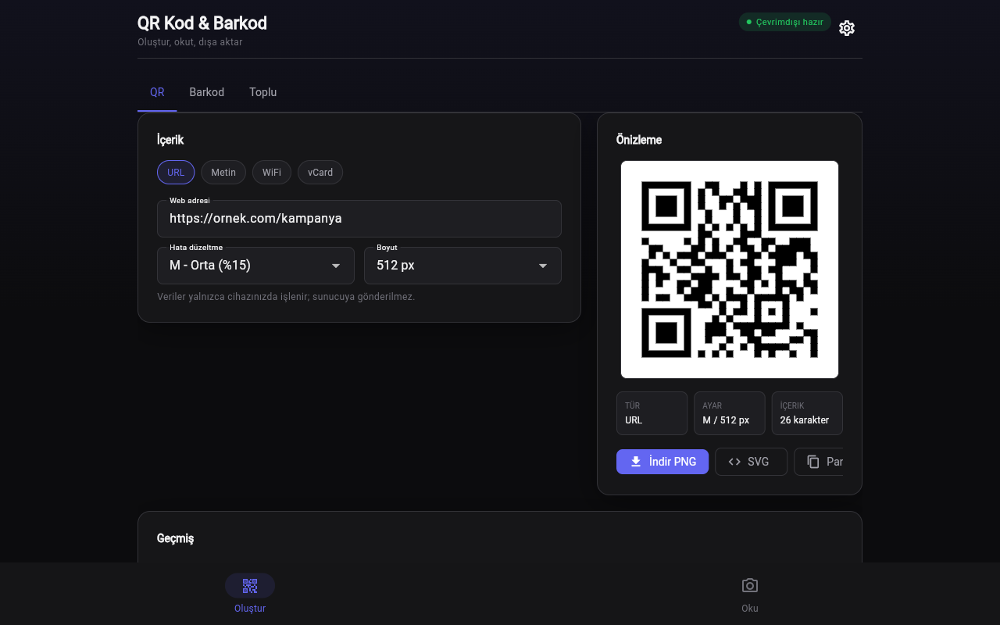

# QR Kod & Barkod

Çevrimdışı çalışan QR kod ve barkod oluşturucu/okuyucu. Flutter üzerine kuruludur, veriler cihazdan çıkmaz.



## Özellikler

- URL, metin, Wi-Fi ve vCard için QR oluşturma, PNG veya SVG çıktı
- Hata düzeltme seviyesi L/M/Q/H, çıktı boyutu 512/1024 px
- Code128 ve EAN-13 barkod (kontrol basamağı otomatik)
- CSV/TXT'den toplu üretim, ZIP çıktı (en fazla 100 satır)
- Kamerayla okuma (Android/iOS/macOS)
- Görsel dosyasından ve panodan okuma, tüm platformlarda
- Okunan URL açılmadan önce onay istenir
- Oluşturma ve okuma geçmişi, JSON dışa/içe aktarma, Wi-Fi şifresi maskeleme
- Açık/koyu/sistem teması

## Çalıştırma

```powershell
.\run.ps1             # Windows > Chrome > Edge sırasıyla ilk uygun cihaz
.\run.ps1 chrome      # cihazı elle seç
.\run.ps1 -Check      # flutter analyze + flutter test
.\build.ps1 -windows  # analiz + test + release derleme (veya -android)
.\publish.ps1         # exe -> dist\hizli-qr-kod-ve-barkod-olusturucu-okuyucu\
```

Windows exe ve Windows masaüstü hedefi için Geliştirici Modu açık olmalıdır: `start ms-settings:developers`. Mod kapalıyken `run.ps1` Chrome/Edge'e düşer.

## Kullanım

| Kısayol (Oku sekmesi) | İşlev |
|-----------------------|-------|
| `Ctrl+O` | Görsel dosyası aç ve içindeki kodu oku |
| `Ctrl+V` | Panodan yapıştır (görsel veya metin) |

## Veri

Geçmiş ve ayarlar `SharedPreferences` içinde saklanır. Hesap ve telemetri yoktur; ağ erişimi yalnızca okunan bir bağlantıyı açmayı onayladığınızda sistem tarayıcısı üzerinden olur.
