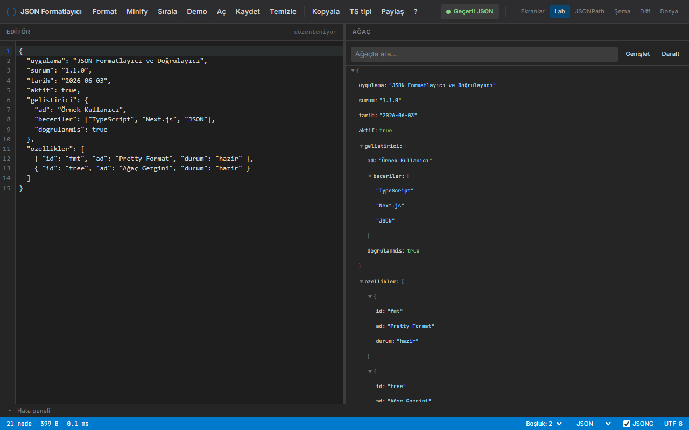

# JSON Formatlayıcı ve Doğrulayıcı

JSON'u yerelde formatlayan, doğrulayan, sorgulayan ve karşılaştıran VS Code tarzı araç. Next.js ile yazıldı, masaüstü sürümü Electron üzerinde çalışır.



## Özellikler

- CodeMirror 6 editör ve sanal ağaç görünümü, ayarlanabilir ayırıcı
- Format, Minify, anahtarları sıralama; girinti 2 veya 4 boşluk
- Satır ve sütunlu hata paneli, Onar (tek tırnak, sondaki virgül, BOM)
- JSON, NDJSON ve JSONC (yorumlu JSON) desteği, yinelenen anahtar uyarısı
- Ağaçta arama, düğüm başına JSONPath / JSON Pointer / değer kopyalama
- JSON'dan TypeScript tipi üretme ve içeriği `#d=` bağlantısıyla paylaşma (yalnızca web)
- `/jsonpath`: JSONPath ve jq-lite sorguları
- `/schema`: JSON Schema (Draft-07, Ajv) doğrulama
- `/diff`: yol bazlı özet ve satır farkı

## Çalıştırma

```powershell
.\run.ps1          # kaynaktan çalıştır -> http://localhost:3103/lab
.\run.ps1 -Check   # vitest + tsc + statik export
.\run.ps1 -UiTest  # Playwright arayüz testleri (pencere açar)
.\publish.ps1      # exe -> dist\json-formatlayici-ve-dogrulayici\
```

## Kullanım

| Kısayol | İşlev |
|---|---|
| Ctrl+Shift+F | Format |
| Ctrl+Shift+M | Minify |
| Ctrl+Shift+K | Anahtarları sırala |
| Ctrl+O / Ctrl+S | Dosya aç / kaydet (indir) |
| Ctrl+Enter | Şema ekranında doğrula |
| F1 | Yardım (Esc kapatır) |

## Veri

Taslak ve ayarlar `localStorage`'da tutulur: web'de tarayıcı profilinde, exe'de `%APPDATA%\JSON Formatlayici\` altında. Tüm işlemler yerelde çalışır, ağ erişimi yoktur; paylaşım bağlantısı içeriği URL'nin `#` kısmında taşır.
