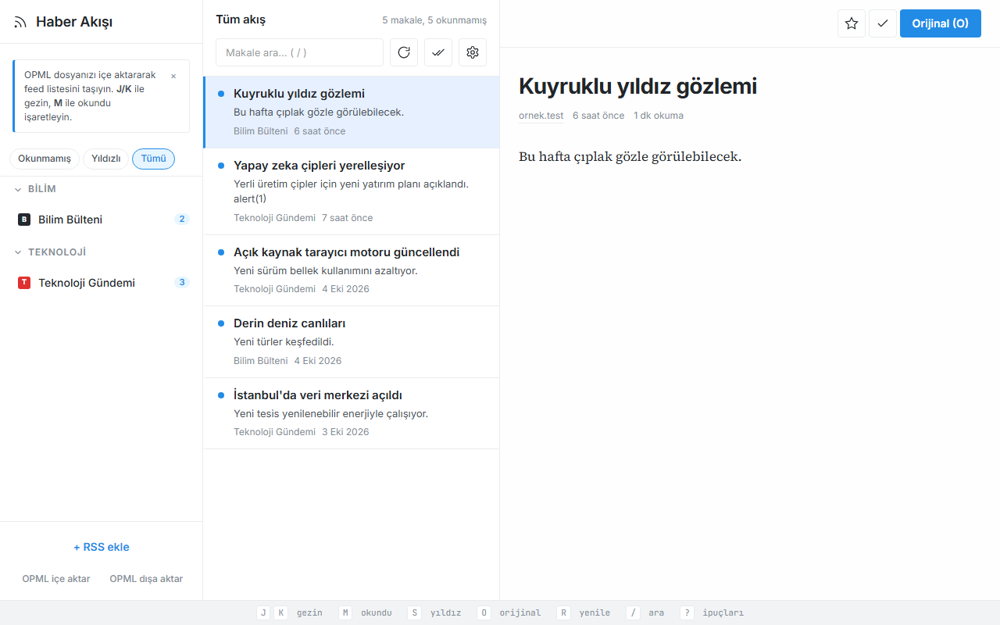

# Kişiselleştirilebilir Haber ve İçerik Akış Paneli

RSS/Atom akışlarını yerel SQLite'ta toplayan, kendi bilgisayarınızda çalışan üç sütunlu haber okuyucu. Next.js ve Prisma ile yazıldı, masaüstü sürümü Electron kabuğunda çalışır.



## Özellikler

- Üç sütun: feed listesi, makale listesi, okuyucu (mobilde sekmeler)
- Okunmamış / Yıldızlı / Tümü filtreleri, tümünü okundu işaretleme
- Başlık ve özette Türkçe harf duyarsız arama
- RSS/Atom ekleme, klasörleme, OPML içe/dışa aktarma
- Arka planda otomatik senkron: 5 / 15 / 30 / 60 dk
- Hatalı feed'de makaleler korunur, hata feed'in yanında gösterilir
- Makale HTML'i DOMPurify ile temizlenir
- Yerel ve özel ağ adreslerine istek engellenir (SSRF koruması)

## Çalıştırma

```powershell
.\run.ps1          # kaynaktan çalıştır -> http://localhost:3104
.\run.ps1 -Check   # vitest + tsc + Playwright e2e (internet gerekmez)
.\publish.ps1      # exe -> dist\kisisellestirilebilir-haber-ve-icerik-akis-paneli\
```

Kaynaktan çalıştırmak için Node.js 22.5+ gerekir.

## Kullanım

| Kısayol | İşlev |
|---|---|
| J / K | Sonraki / önceki makale |
| M | Okundu / okunmadı |
| S | Yıldızla |
| O | Orijinali aç |
| R | Feed'leri yenile |
| / | Aramaya odaklan (Esc temizler) |
| ? | Kısayol çubuğunu göster/gizle |

## Veri

Veriler yerel SQLite'ta tutulur: kaynaktan `prisma\dev.db`, exe'de `%APPDATA%\Haber Akis Paneli\haber.db`. Uygulama yalnızca abone olunan feed adreslerine bağlanır, telemetri yoktur.
