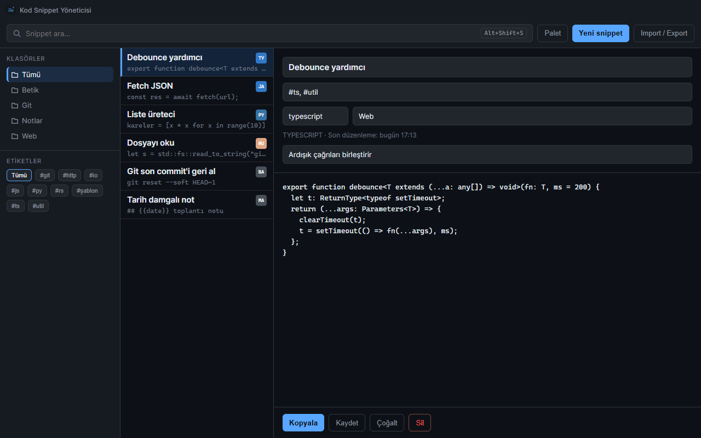

# Kod Parçası Snippet Yöneticisi

Kod parçalarını yerelde saklayan Electron masaüstü uygulaması. Alt+Shift+S arama paletiyle snippet'ler her uygulamanın üstünden aranıp kopyalanabilir.



## Özellikler

- Snippet ekleme, düzenleme, çoğaltma ve silme (başlık, açıklama, dil, etiket, klasör)
- Başlık, kod, dil, klasör ve etikette Türkçe harf duyarsız anlık arama
- Klasör ve etiket filtreleri, klavyeyle liste gezinme
- Global Alt+Shift+S arama paleti: boş sorguda son kullanılanlar, Enter kopyalar
- Kopyalarken genişleyen yer tutucular: `{{date}}`, `{{time}}`, `{{datetime}}`, `{{user}}`, `{{hostname}}`, `{{year}}`
- JSON içe ve dışa aktarma (önizleme özeti, var olan id'ler atlanır)
- Tek örnek: ikinci açılış mevcut pencereyi öne getirir

## Çalıştırma

```powershell
.\run.ps1          # kaynaktan çalıştır (Vite 5173 portu)
.\run.ps1 -Check   # tip kontrolü + birim testleri + derleme
.\run.ps1 -UiTest  # arayüz testleri (pencere açar)
.\publish.ps1      # exe -> dist\kod-parcasi-snippet-yoneticisi\
```

Kaynaktan çalıştırmak için Node.js 22.12+ ve Windows 10/11 gerekir. Alt+Shift+S başka bir uygulamada kayıtlıysa araç çubuğunda uyarı çıkar, palet Palet düğmesiyle açılır.

## Kullanım

| Kısayol | İşlev |
|---|---|
| Alt+Shift+S (global) | Arama paletini aç |
| Ctrl+N | Yeni snippet |
| Ctrl+S | Kaydet |
| Ctrl+F | Aramaya odaklan |
| Ctrl+E | Import / Export |
| Esc | Modalı / paleti kapat |
| Palette: Enter / Ctrl+Enter | Kopyala / ana pencerede düzenle |

## Veri

Tüm snippet'ler `%AppData%\kod-parcasi-snippet-yoneticisi\snippets.json` dosyasında tutulur. Dosya bozulursa silinmez, `snippets.corrupt-<zaman>.json` olarak kenara alınır. Ağ erişimi yoktur.
