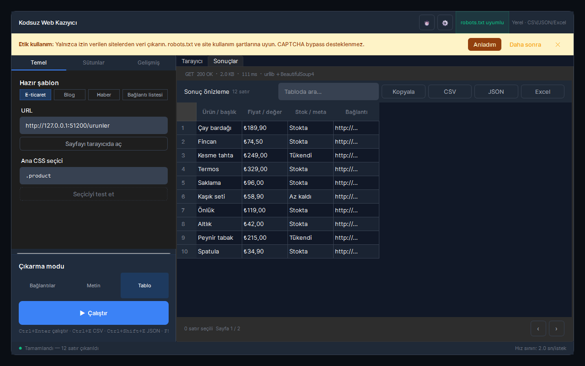

# Kodsuz Web Kazıyıcı

URL ve CSS seçici ile web sayfalarından kod yazmadan veri çıkaran PySide6 masaüstü uygulaması.



## Özellikler

- Gömülü tarayıcı (Qt WebEngine) ile JS/SPA sayfalarını ayrıştırma, istenirse statik mod
- Element seç ile sayfada tıklayarak CSS seçici üretme
- Üç mod: bağlantılar, metin, tablo (sütun başına alt seçici, `a@href` gibi öznitelik desteği)
- Hazır şablonlar (E-ticaret, Blog, Haber, Bağlantı listesi) ve seçici testi
- Lazy-load için otomatik kaydırma, statik modda `rel="next"` sayfalama takibi
- robots.txt ve `Crawl-delay` uygulanır, aynı sunucuya istekler arasında hız sınırı
- CSV, JSON ve Excel (.xlsx) dışa aktarma, son 20 çalıştırma geçmişi

## Çalıştırma

```powershell
.\run.ps1          # .venv oluşturur, requirements.txt kurar, uygulamayı açar
.\run.ps1 -Check   # pytest testlerini çalıştırır
.\publish.ps1      # testler + PyInstaller -> dist\kodsuz-web-kaziyici-scraper\
```

Python 3.11+ gerekir. Exe klasörü (`KodsuzWebKaziyici.exe` + `_internal`) birlikte taşınmalıdır.

## Kullanım

| Kısayol | İşlev |
| --- | --- |
| `Ctrl+Enter` / `F5` | Çalıştır |
| `Ctrl+E` | CSV olarak dışa aktar |
| `Ctrl+Shift+E` | JSON olarak dışa aktar |
| `Ctrl+Shift+X` | Excel (.xlsx) olarak dışa aktar |

## Veri

Ayarlar ve geçmiş `~/.kodsuz-web-kaziyici/settings.json` dosyasında tutulur (Windows'ta `%USERPROFILE%\.kodsuz-web-kaziyici`). Uygulama yalnızca girilen adrese ve o sunucunun `/robots.txt` dosyasına bağlanır, telemetri yoktur.
