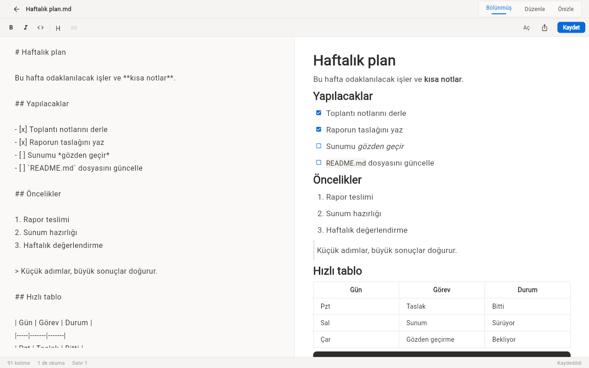

# Markdown Not Defteri

Yerel `.md` dosyaları ve hızlı notlar için canlı önizlemeli markdown editörü. Flutter ile yazıldı, Windows ve web'de çalışır.



## Özellikler

- Bölünmüş / Düzenle / Önizle modları
- Araç çubuğu: kalın, italik, kod, H1, link
- `.md` dosyası açma, değişiklikler 2 sn sonra otomatik kaydedilir
- Son açılan 10 dosya ana sayfada
- Hızlı notlar, Türkçe harf duyarsız arama, silmeyi geri alma
- Markdown (.md) veya tek dosyalık HTML olarak dışa aktarma
- Önizlemede tablo, görev listesi, kod blokları ve göreli görseller
- Kelime sayısı, okuma süresi ve kayıt durumu alt çubukta
- Sepia / Koyu / Sistem tema

## Çalıştırma

```powershell
.\run.ps1          # Windows > Chrome > Edge sırasıyla ilk uygun cihaz
.\run.ps1 chrome   # cihazı elle seç
.\run.ps1 -Check   # flutter analyze + flutter test
.\publish.ps1      # exe -> dist\markdown-not-defteri\markdown_not_defteri.exe
```

Flutter SDK gerekir. Windows exe ve Windows masaüstü hedefi için Geliştirici Modu açık olmalıdır: `start ms-settings:developers`. Mod kapalıyken `run.ps1` Chrome/Edge'e geçer. Web'de dosya açma/kaydetme yoktur.

## Kullanım

| Kısayol | İşlev |
|---------|-------|
| `Ctrl+S` | Kaydet |
| `Ctrl+B` | Seçimi kalın yap |
| `Ctrl+I` | Seçimi italik yap |

## Veri

Hızlı notlar, son dosyalar ve tema `SharedPreferences` içinde tutulur (Windows'ta AppData klasöründe, web'de `localStorage`'da). Açılan `.md` dosyaları olduğu yerde kalır. Ağ erişimi ve telemetri yoktur.
