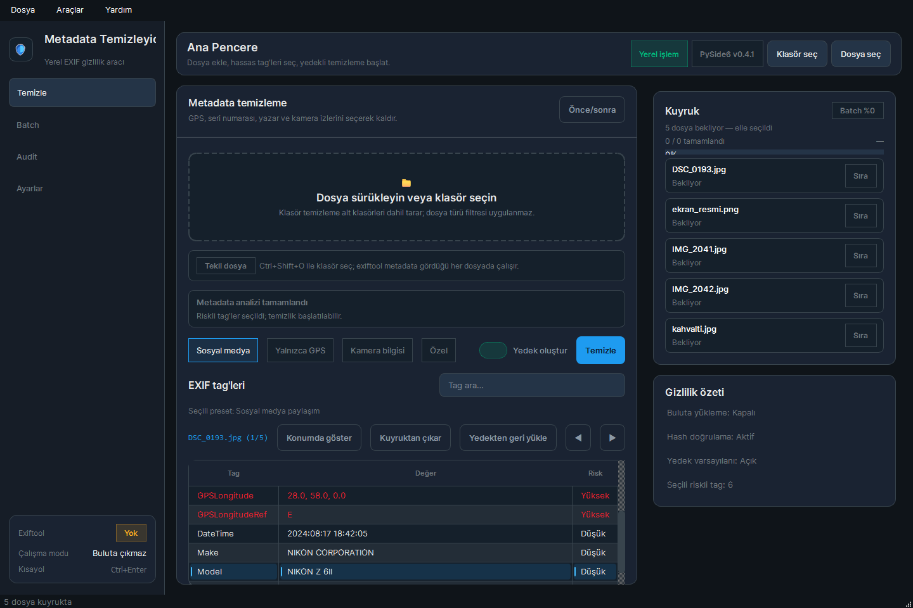

# Metadata Temizleyici

Fotoğraf ve PDF'lerdeki EXIF/GPS/XMP/IPTC metadata'sını yerelde toplu temizleyen PySide6 masaüstü uygulaması. exiftool kuruluysa videoları da temizler.



## Özellikler

- Sürükle-bırak veya alt klasörler dahil klasör taraması
- Metadata önizleme ve risk etiketleri
- Presetler: sosyal medya, yalnızca GPS, kamera bilgisi, özel tag listesi
- JPEG, PNG ve WebP'de kayıpsız temizlik, ICC profili ve yön etiketi korunur
- Paralel toplu temizleme, simülasyon modu, `.bak` yedek ve geri yükleme
- CSV audit raporu, JSON metadata export, önce/sonra karşılaştırma
- Klasör izleme ve sistem tepsisi
- CLI: `python cli.py read|clean|check|restore|presets`

## Çalıştırma

```powershell
.\run.ps1          # .venv oluşturur, requirements.txt kurar, uygulamayı açar
.\run.ps1 -Check   # testler
.\publish.ps1      # exe -> dist\metadata-temizleyici\
```

Python 3.11+ gerekir. Video ve RAW gibi biçimler için exiftool PATH'te olmalı veya `.\scripts\install-exiftool.ps1` ile `sidecar\` klasörüne kurulmalıdır.

## Veri

Ayarlar `~/.metadata-temizleyici/settings.json` dosyasında tutulur. Dosyalar yerelde işlenir.
