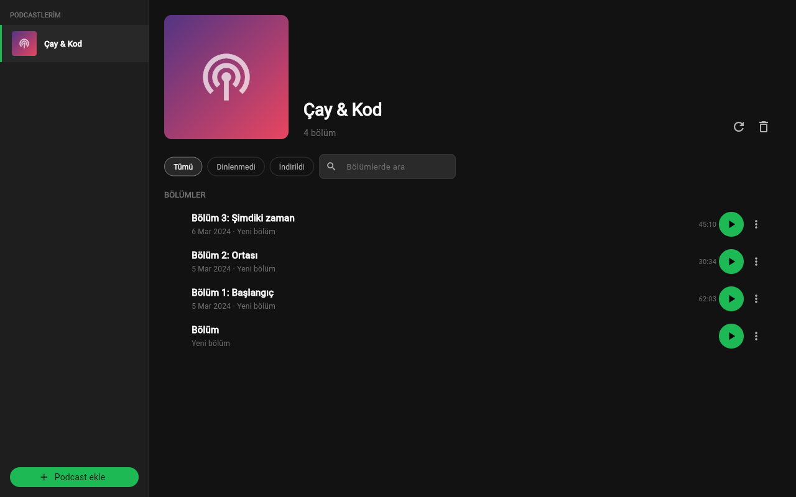

# Minimalist Podcast

Koyu temalı, reklamsız RSS podcast dinleyici. Flutter ile yazıldı; abonelikler, sıra ve dinleme konumu yerel SQLite'ta (Drift) tutulur.



## Özellikler

- RSS adresiyle podcast ekleme (feed eklemeden önce doğrulanır), OPML içe/dışa aktarma
- Bölüm listesi, filtreler (tümü / dinlenmedi / indirildi) ve Türkçe harf duyarsız arama
- Kaldığın yerden devam, çevrimdışıyken bölüm önbelleği
- Oynatıcı: hız 0.8x ile 2x arası, Smart Speed, 15 sn geri / 30 sn ileri, uyku zamanlayıcı, chapter listesi
- Sürükle-bırak dinleme sırası, bölüm bitince sıradakine geçer
- Offline indirme, varsayılan olarak yalnızca Wi-Fi ile (yalnızca masaüstü/mobil)
- OPML klasör senkronu (yalnızca masaüstü/mobil)

## Çalıştırma

```powershell
.\run.ps1          # Chrome > Edge > Windows sırasıyla ilk uygun cihaz
.\run.ps1 chrome   # cihazı elle seç
.\run.ps1 -Check   # flutter analyze + flutter test
.\publish.ps1      # exe -> dist\minimalist-podcast-uygulamasi\
```

Flutter SDK ve Chrome gerekir. Web hedefinde `run.ps1` yerel CORS proxy'yi (port 8766) başlatır. Windows exe için Geliştirici Modu açık olmalıdır: `start ms-settings:developers`. Windows sürümünde ses çalmaz, ses için `.\run.ps1 chrome` kullanın.

## Kullanım

| Kısayol | İşlem |
|---|---|
| Boşluk | Oynat / duraklat (parça yüklüyse) |
| ← | 15 sn geri |
| → | 30 sn ileri |

## Veri

Masaüstünde veriler `getApplicationDocumentsDirectory()` altındaki `minimal_podcast.db` dosyasında, web'de tarayıcının IndexedDB'sinde tutulur. Uygulama yalnızca eklenen RSS adreslerini ve bölümlerin ses/kapak dosyalarını çeker. Web'de RSS istekleri sırayla yerel proxy, `corsproxy.io` ve `api.allorigins.win` üzerinden geçer; son ikisi üçüncü taraftır, Ayarlar'dan kendi proxy adresinizi verebilirsiniz. Analitik ve reklam yoktur.
