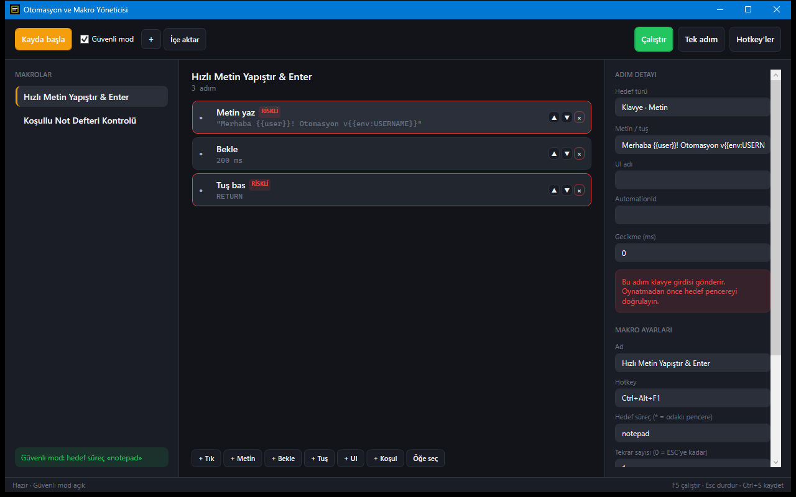

# Otomasyon ve Makro Aracı

Fare ve klavye adımlarını kaydeden, düzenleyen ve tekrar oynatan Windows makro aracı (WPF, .NET 10). Oynatma sırasında fiziksel `Esc` tuşu makroyu durdurur.



## Özellikler

- Global kayıt: sol tık, yazılan metin, özel tuşlar ve aradaki bekleme süreleri; kayıt duraklatılabilir
- Adım editörü: tıkla, metin yaz, bekle, tuş bas, UI öğesine tıkla (UIAutomation), pencere başlığı koşulu, atla
- Değişkenler: `{{clipboard}}`, `{{date}}`, `{{time}}`, `{{datetime}}`, `{{user}}`, `{{env:AD}}`
- Makro başına global kısayol (ör. `Ctrl+Alt+F1`) ve gün/saat zamanlayıcısı; çakışan kısayollar listelenir
- Tekrar sayısı (`0` = `Esc` ile durdurulana kadar) ve kısayolsuz kopya oluşturma
- Güvenli mod: girdiler yalnızca odaklı pencereye veya belirli bir sürece gider, riskli adımlarda onay istenir
- Tek adım (debug) çalıştırma, oynatma ilerlemesi ve durum çubuğu
- SQLite ile saklama, `.macro.json` içe/dışa aktarma

## Çalıştırma

```powershell
.\run.ps1          # kaynaktan çalıştır
.\run.ps1 -Check   # testler
.\publish.ps1      # exe -> ..\dist\otomasyon-ve-makro-araci\
.\install.ps1      # %LOCALAPPDATA%\Programs\OtomasyonMakro altına kurar, kısayol oluşturur
.\uninstall.ps1    # kaldırır (makrolar korunur)
```

Gereksinim: Windows 10/11; geliştirme için .NET 10 SDK.

## Kullanım

1. Soldan bir makro seçin veya **+** ile yenisini oluşturun.
2. **Kayda başla** (`Ctrl+Alt+M`) ile kaydedin, **Durdur ve kaydet** ile bitirin. Adımları `+ Tık`, `+ Metin`, `+ Bekle`, `+ Tuş`, `+ UI`, `+ Koşul` ile elle de ekleyebilirsiniz.
3. Sağ panelde adımı, kısayolu, hedef süreci (`*` = odaklı pencere), tekrar sayısını ve zamanlayıcıyı düzenleyip **Kaydet**'e basın.
4. **Çalıştır** (`F5`) veya **Tek adım** (`Shift+F5`) ile oynatın. `Esc` oynatmayı her zaman durdurur. `Ctrl+S` kaydeder.

## Veri

Makrolar `%LOCALAPPDATA%\OtomasyonMakro\macros.db` içinde tutulur; `OTOMASYONMAKRO_DATA_DIR` ile konum değiştirilebilir. Ağ erişimi ve telemetri yoktur. Kayıt sırasında yazılan tuşlar makro adımı olarak yerel veritabanına yazılır, bu yüzden parola gibi girdileri kaydetmeyin.
