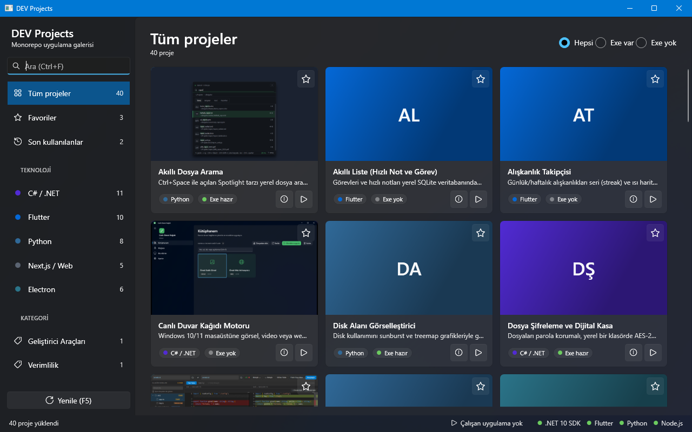

# Proje Launcher

Bu monorepodaki uygulamaları ekran görüntülü kartlarla listeleyen, arayıp süzen ve tek tıkla açan WPF galeri (`DevProjects.exe`, .NET 10).



## Özellikler

- Her proje için kart: `docs/ekran.png` küçük resmi, ad, tek satır açıklama, yığın rozeti, exe durumu ve "Çalışıyor" etiketi
- Kenar çubuğu: tüm projeler, favoriler, son kullanılanlar; teknolojiye ve `assets/manifest.json` `category` alanına göre gruplar
- Türkçe harf duyarsız arama (`ogrenme` -> "Öğrenme"); ad, açıklama, etiket, klasör ve kategoride arar
- Exe filtresi: Hepsi / Exe var / Exe yok
- Detay sayfası: ekran görüntüleri, README girişi ve özellikleri, etiketler, klasör ve exe yolu
- Eylemler: aç, kaynaktan çalıştır, exe üret, testleri çalıştır, klasörü veya README'yi aç
- Durum çubuğunda çalışan uygulamalar ve araç zinciri denetimi
- Windows açık/koyu temasını ve vurgu rengini izleyen Fluent görünüm

## Çalıştırma

```powershell
.\run.ps1          # kaynaktan çalıştır
.\run.ps1 -Check   # testler
.\run.ps1 -UiTest  # FlaUI arayüz testleri (pencere açar)
.\publish.ps1      # exe -> ..\DevProjects.exe
```

Bu proje exe'yi `dist\` yerine repo köküne yazar; kök `launcher.ps1 -Wpf` onu orada arar.

## Kullanım

| Kısayol | İşlev |
|---|---|
| Ctrl+F | Arama kutusu |
| Ok tuşları | Kartlar arasında gezin |
| Enter | Seçili kartın detayı |
| Ctrl+Enter | Seçili projeyi aç |
| Esc | Detayı kapat, aramayı temizle, filtreleri sıfırla |
| Geri silme / Alt+← | Detaydan galeriye dön |
| F5 | Yenile |

## Veri

Favoriler ve son kullanılanlar `%LOCALAPPDATA%\DevProjects\state.json` içinde tutulur (`DEVPROJECTS_STATE_DIR` ile değiştirilebilir). Ağ erişimi yoktur.
