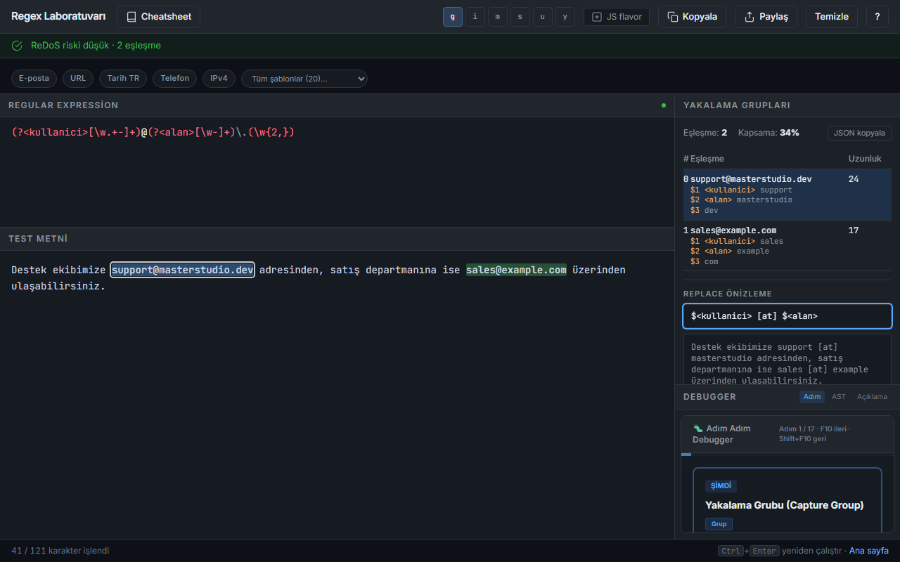

# Regex Test ve Öğrenme Aracı

Düzenli ifadeleri canlı test eden, adım adım açıklayan ve Türkçe cheatsheet sunan yerel regex laboratuvarı (Next.js, masaüstü için Electron).



## Özellikler

- Canlı eşleşme vurgulama (CodeMirror 6), `g i m s u y` bayrakları ve sözdizimi renklendirme
- Eşleşme tablosunda yakalama grupları; satıra tıklayınca eşleşme metinde seçilir
- Replace önizleme (`$1`, `$&`, `$<ad>`) ve sonucu kopyalama
- Adım adım debugger, AST ağacı ve Türkçe açıklama
- ReDoS risk skoru; riskli kalıplar ve büyük metinler 2 sn zaman aşımıyla Web Worker'da çalışır
- PCRE/Python sözdizimi uyumsuzluk uyarıları
- Hazır şablonlar, son 8 kalıp geçmişi ve `?s=` paylaşım bağlantısı (yalnızca web)
- Aranabilir Türkçe cheatsheet; "Laboratuvarda dene" kalıbı örnek metinle yükler

## Çalıştırma

```powershell
.\run.ps1          # kaynaktan çalıştır -> http://localhost:3105/lab
.\run.ps1 -Check   # vitest + tsc + statik export
.\run.ps1 -UiTest  # Playwright arayüz testleri (pencere açar)
.\publish.ps1      # exe -> dist\regex-test-ve-ogrenme-araci\
```

## Kullanım

| Kısayol | İşlev |
|---|---|
| Ctrl+Enter | Yeniden çalıştır |
| Ctrl+Shift+C | Kalıbı `/kalıp/bayrak` olarak kopyala |
| Ctrl+Shift+M | Eşleşmeleri JSON olarak kopyala |
| F10 / Shift+F10 | Debugger ileri / geri |
| Esc | ReDoS uyarısını / yardım penceresini kapat |
| F1 | Kısayol yardımı |

## Veri

Oturum ve geçmiş `localStorage`'da tutulur: web'de tarayıcı profilinde, exe'de `%APPDATA%\Regex Test ve Ogrenme\` altında. Ağ erişimi yoktur. Paylaşım bağlantısı kalıbı ve test metnini URL'de taşır; metinde kişisel veri görülürse önce uyarı çıkar.
