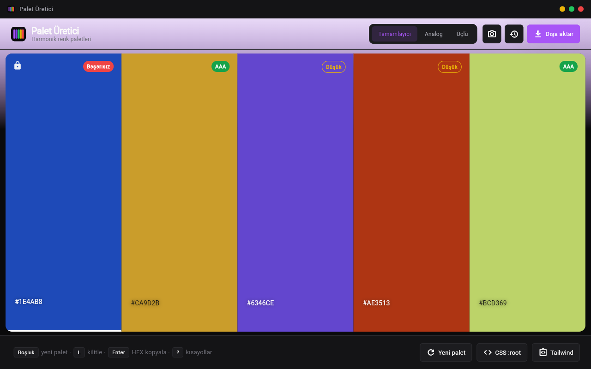

# Renk Seçici ve Palet Üretici

Harmonik 5 renkli palet üreten, WCAG kontrastını gösteren ve CSS/SCSS/Tailwind/JSON olarak dışa aktaran Flutter uygulaması (Windows, web ve mobil).



## Özellikler

- Tamamlayıcı, analog ve üçlü (triadic) palet modları; kilitli renkler korunur
- Her renkte WCAG kontrast rozeti (AAA / AA / Düşük / Başarısız); oran aşağı yuvarlanır
- Dışa aktarma: CSS `:root`, SCSS değişkenleri, Tailwind `colors` veya JSON, panoya kopyala
- HEX ile renk düzenleme (`#38F`, `3388ff` gibi girdiler); elle girilen renk kilitlenir
- Görselden palet ve arayüz teması çıkarma (dosya, kamera, ekran görüntüsü)
- Son 20 palet geçmişi
- Dar pencerede (< 600 px) mobil yerleşim

## Çalıştırma

```powershell
.\run.ps1          # kaynaktan çalıştır (Windows > Chrome > Edge)
.\run.ps1 chrome   # cihazı elle seç
.\run.ps1 -Check   # flutter analyze + flutter test
.\publish.ps1      # exe -> dist\renk-secici-ve-palet-uretici\
```

Gereksinim: Flutter SDK; Windows için Visual Studio "Desktop development with C++". Windows exe için Geliştirici Modu açık olmalı (`start ms-settings:developers`); kapalıysa `.\run.ps1 chrome` kullanılabilir.

## Kullanım

| Kısayol | İşlem |
|---|---|
| `Boşluk` | Yeni palet (kilitsiz renkler) |
| `L` | Seçili rengi kilitle / aç |
| `Enter` | Seçili rengin HEX'ini kopyala |
| `1`-`5` | Renk seç |
| `E` | HEX düzenle |
| `C` / `T` | CSS / Tailwind dışa aktar |
| `H` / `I` | Geçmiş / görselden tema |
| `?` | Kısayol yardımı |

## Veri

Tek kalıcı veri palet geçmişidir (`shared_preferences`, `palet:history` anahtarı): Windows'ta uygulama verisi klasöründeki `shared_preferences.json`, web'de `localStorage`. Ağ erişimi yoktur; görseller yalnızca bellekte işlenir.
