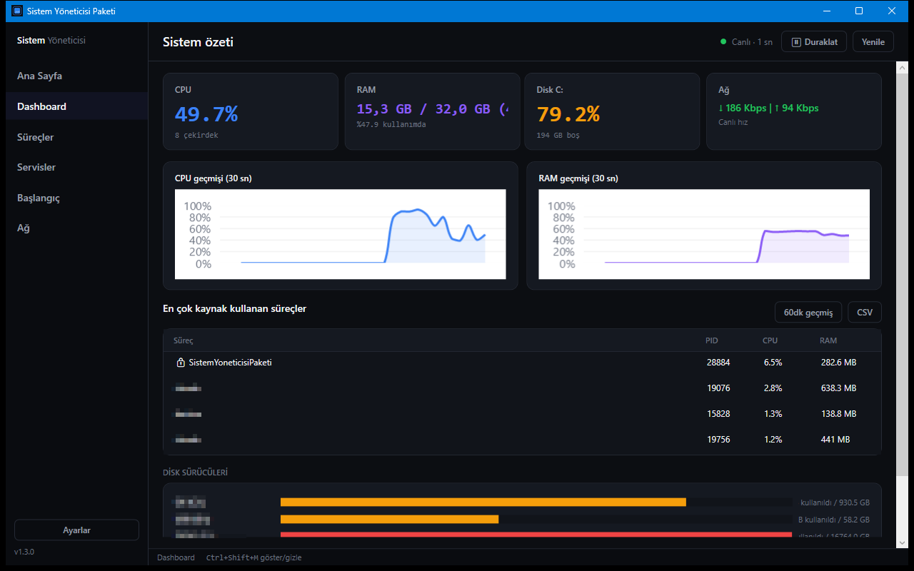

# Sistem Yöneticisi Paketi

Windows için yerel sistem monitörü ve yöneticisi (WPF, .NET 10): CPU/RAM/disk/ağ izleme, süreç, servis, başlangıç öğesi ve bağlantı yönetimi.



## Özellikler

- Dashboard: CPU, RAM, disk ve ağ kartları, 30 sn'lik canlı grafikler, en çok kaynak kullanan süreçler, CSV dışa aktarma
- Eşik ve süresi ayarlanabilen CPU/RAM alarmları
- Süreçler: arama, sıralama, onaylı sonlandırma, CSV dışa aktarma
- Servisler: Windows servislerini başlat, durdur, yeniden başlat
- Başlangıç öğeleri: Registry Run ve Başlangıç klasörü; kaldırılan öğe yedeklenir ve geri alınabilir
- Ağ: aktif TCP/UDP bağlantıları (IPv4), sahibi olan süreç ve PID
- Kritik süreçler ve servisler kilitli gösterilir, sonlandırılamaz veya durdurulamaz
- Sistem tepsisi, global kısayol, isteğe bağlı SQLite metrik geçmişi, yüksek kontrast modu

## Çalıştırma

```powershell
.\run.ps1          # kaynaktan çalıştır
.\run.ps1 -Check   # testler
.\publish.ps1      # exe -> ..\dist\sistem-yoneticisi-paketi\
.\install.ps1      # %LocalAppData%\Programs altına kurar, kısayol oluşturur
.\uninstall.ps1    # kaldırır
```

Pencere kapatılınca tepside kalır; çıkmak için tepsi menüsünden **Çıkış**. Servis işlemleri için uygulamayı yönetici olarak çalıştırın. Geliştirme için .NET 10 SDK gerekir.

## Kullanım

| Kısayol | İşlev |
|---|---|
| 1 / 2 / 3 / 4 / 5 | Dashboard / Süreçler / Servisler / Başlangıç / Ağ |
| Ctrl+, | Ayarlar |
| Ctrl+Shift+M | Pencereyi göster / gizle (global) |

## Veri

Ayarlar, günlük, metrik geçmişi ve başlangıç yedekleri `%LocalAppData%\SistemYoneticisiPaketi\` altında tutulur; `SISTEM_YONETICISI_DATA_DIR` ile konum değiştirilebilir. Ağ erişimi ve telemetri yoktur.
