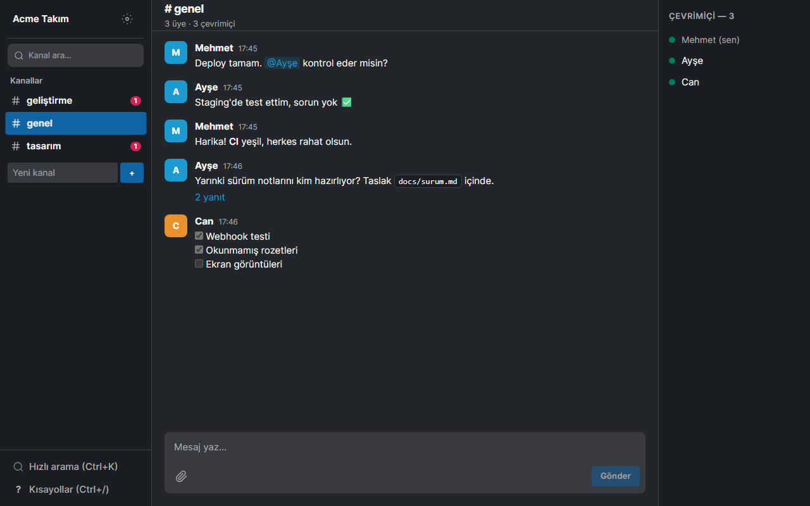

# Takım İletişim ve Sohbet Aracı

Kendi sunucunuzda veya masaüstünde çalışan, Slack benzeri anlık takım sohbeti (Next.js, Socket.IO, masaüstü için Electron).



## Özellikler

- Genel kanallar, birebir mesaj (DM) ve thread yanıtları
- Anlık mesaj, düzenleme, silme, "yazıyor" göstergesi ve çevrimiçi durumu
- Markdown (GFM), @mention vurgusu ve dosya eki (yerel disk veya S3/MinIO)
- Kanal ve thread başına otomatik taslak, okunmamış rozetleri
- Ctrl+K ile mesaj araması
- Koyu / açık tema ve görünen ad değiştirme
- CI bildirimleri için gelen webhook: `POST /api/webhooks/<token>` `{"text": "..."}`
- KVKK: kişisel veriyi JSON olarak dışa aktarma ve hesap silme
- Docker Compose (SQLite + Redis) ile dağıtım

## Çalıştırma

```powershell
.\run.ps1          # kaynaktan çalıştır -> http://localhost:3106
.\run.ps1 -Check   # birim + tip + e2e testleri
.\run.ps1 -UiTest  # arayüz testleri
.\publish.ps1      # exe -> dist\takim-iletisim-ve-sohbet-araci\
```

`run.ps1` bağımlılıkları, `.env`'i, veritabanını ve demo veriyi kendisi hazırlar. Demo hesaplar: `mehmet@acme.local`, `ayse@acme.local`, `can@acme.local`, şifre `demo1234`. Docker: `docker compose up` (port 3000).

## Kullanım

| Kısayol | İşlev |
|---|---|
| Ctrl+K | Mesajlarda hızlı arama |
| Alt+↑ / Alt+↓ | Önceki / sonraki kanal |
| Enter / Shift+Enter | Gönder / yeni satır |
| Esc | Düzenlemeden vazgeç; thread'i, menüyü veya diyaloğu kapat |
| Ctrl+/ | Kısayol listesi |

## Veri

Kaynaktan çalışırken veriler `prisma\dev.db` ve `uploads\` içinde, masaüstü exe'de `%APPDATA%\Takim Sohbet\` altında tutulur. Telemetri yoktur; masaüstü sunucusu yalnızca `127.0.0.1` dinler ve dışarıya sadece yapılandırdığınız Redis / S3 / LiveKit adreslerine bağlanır.
