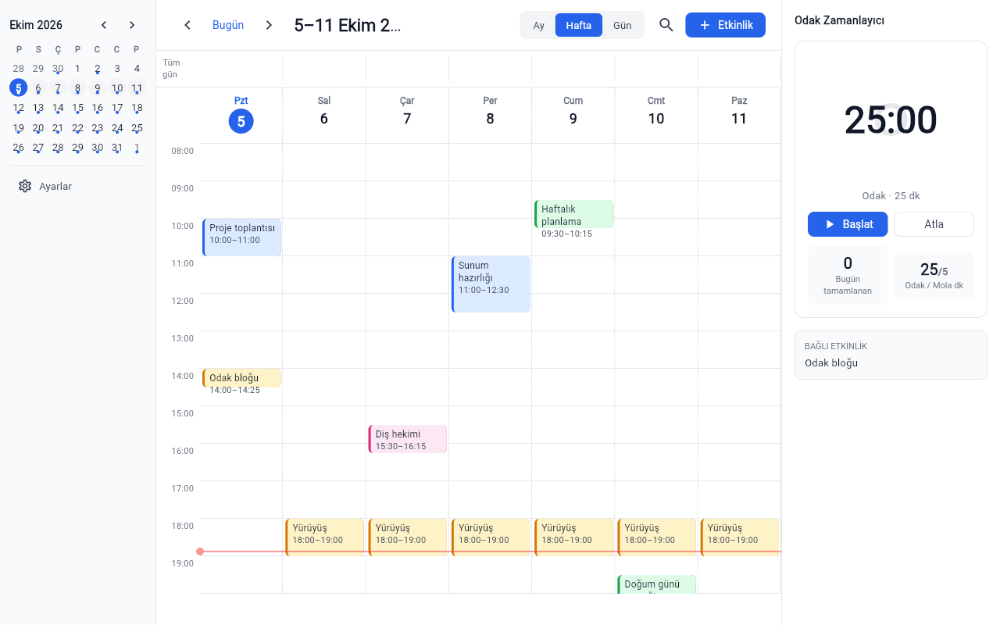

# Takvim ve Zamanlayıcı

Pomodoro sayaçlı, çevrimdışı çalışan Türkçe takvim uygulaması (Flutter). Hesap gerektirmez.



## Özellikler

- Ay / hafta / gün görünümü, mini takvim ve arama
- Günlük, haftalık, aylık tekrarlayan etkinlikler ve tüm gün etkinlikleri
- Türkçe doğal dil girişi: "Yarın 15:00 toplantı", "Cuma 10:30 doktor"
- Pomodoro (odak / kısa / uzun mola), isteğe bağlı takvime otomatik odak bloğu
- Hatırlatıcılar: Android/iOS/macOS'ta sistem bildirimi, Windows ve web'de uygulama açıkken uygulama içi uyarı
- ICS ve JSON dışa/içe aktarma
- Açık / koyu / sistem teması

## Çalıştırma

```powershell
.\run.ps1          # kaynaktan çalıştır (Windows > Chrome > Edge)
.\run.ps1 chrome   # cihazı elle seç
.\run.ps1 -Check   # flutter analyze + flutter test
.\publish.ps1      # exe -> dist\takvim-ve-zamanlayici\
```

Gereksinim: Flutter SDK; Windows için Visual Studio C++ araçları. Windows exe için Geliştirici Modu açık olmalı (`start ms-settings:developers`); kapalıysa `.\run.ps1 chrome` kullanılabilir.

## Kullanım

| Kısayol (takvim ekranı) | İşlem |
|---|---|
| `N` | Yeni etkinlik |
| `T` | Bugüne git |
| `/` | Ara |
| `Boşluk` | Pomodoro başlat / duraklat |

## Veri

Tüm veri `shared_preferences` içinde tutulur: Windows'ta uygulama verisi klasöründeki `shared_preferences.json`, web'de `localStorage`. Ağ erişimi, hesap ve analitik yoktur. Ayarlar'daki CalDAV senkronizasyonu henüz çalışmıyor.
