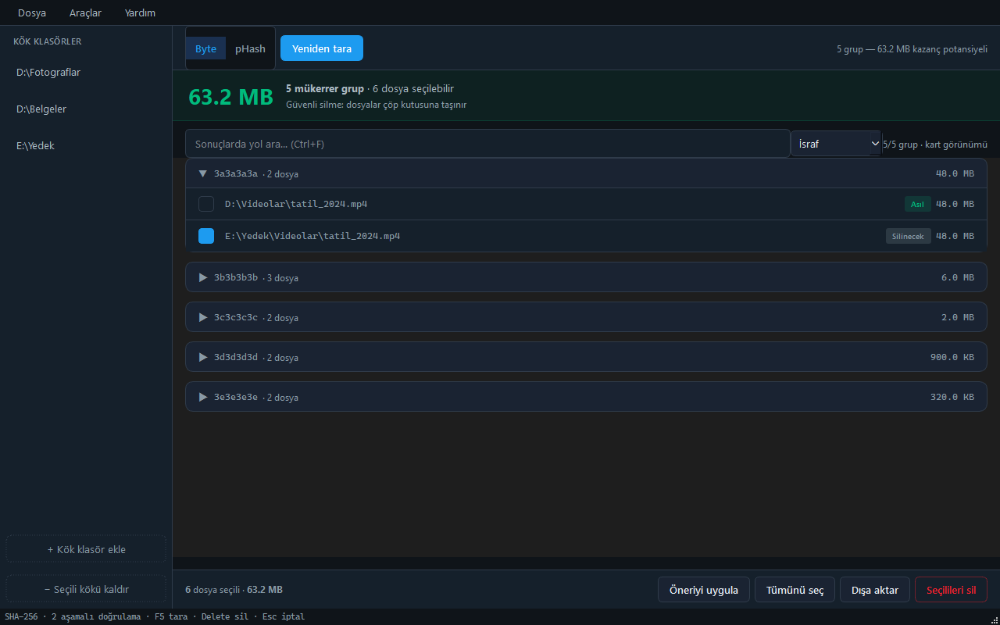

# Tekrarlanan Dosya Bulucu

Aynı içeriğe sahip dosyaları SHA-256 ile bulur ve kopyaları Geri Dönüşüm Kutusu'na taşır. PySide6 ile yazılmış bir masaüstü uygulamasıdır.



## Özellikler

- Birden çok kök klasör tarama (sürükle-bırak veya `Ctrl+O`)
- Boyut, ilk 64 KB ve tam SHA-256 karşılaştırmasıyla kesin eşleşme; paralel hash ve SQLite önbellek
- Gizli/sistem klasörü, uzantı ve en küçük boyut filtreleri; sert bağlantılar ayrı işaretlenir
- pHash ile benzer görsel bulma (isteğe bağlı Pillow + ImageHash)
- Tutulacak kopya önerisi (en eski, en yeni veya en kısa yol); korunan klasörler silinmeye işaretlenmez
- Kart, ağaç ve kompakt liste görünümleri; yol filtresi, sıralama ve sayfalama
- Onaylı silme; kalıcı silme ikinci onay ister
- JSON / CSV / HTML dışa aktarma, oturum kaydetme, tarama geçmişi ve zamanlanmış tarama
- Koyu tema; onay kutularında ekran okuyucu adları, grup kartları klavyeyle açılır

## Çalıştırma

```powershell
.\run.ps1          # kaynaktan çalıştır
.\run.ps1 -Check   # testler
.\run.ps1 -UiTest  # arayüz testleri (pytest-qt, gerçek pencereler)
.\publish.ps1      # exe -> dist\tekrarlanan-dosya-bulucu\
```

İsteğe bağlı pHash/PDF önizleme (kaynaktan): `.\.venv\Scripts\pip install -r requirements-optional.txt`. Linux/macOS: `./run.sh`.

## Kullanım

1. Kök klasörleri ekleyin (sürükleyin ya da `Ctrl+O`).
2. `F5` ile tarayın. Her grupta bir "Asıl" dosya tutulur, kopyalar "Silinecek" olarak işaretlenir.
3. İşaretleri onay kutularıyla düzeltin; `Ctrl+F` ile yol arayın.
4. "Seçilileri sil" veya `Delete`, ardından onay. Dosyalar Geri Dönüşüm Kutusu'na gider.

| Kısayol | İşlev |
|---|---|
| `F5` / `Esc` | Tara / taramayı iptal et |
| `Ctrl+O` | Kök klasör ekle |
| `Ctrl+F` | Sonuçlarda yol ara |
| `Delete` | Seçili kopyaları sil |
| `Ctrl+,` | Ayarlar |
| `F1` | Yardım |

## Veri

Ayarlar, önbellek, geçmiş ve günlük `%LocalAppData%\TekrarlananDosyaBulucu\` altında tutulur. Ağ erişimi ve telemetri yoktur; IPC yalnızca yerel adlandırılmış kanal üzerinden çalışır.
