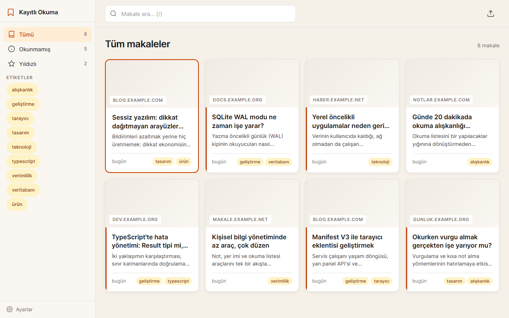

# Kayıtlı Okuma: Web Clipper ve Okuma Listesi

Sayfaları kaydedip yan panelde okumayı sağlayan bir Chrome (MV3) eklentisi. İsteğe bağlı olarak Next.js web arayüzü ve aynı arayüzün Electron ile paketlenmiş masaüstü sürümü de vardır.



## Özellikler

- Popup'tan geçerli sayfayı etiketle kaydetme; seçili metin vurgu olarak eklenir
- Yan panelde okuma listesi: okunmamış / yıldızlı / etiket filtresi, arama, okuma modu
- Eklenti verisi `chrome.storage.local` içinde, sunucu gerekmez
- JSON yedekleme ve içe aktarma; yedek eklenti ile web arayüzü arasında taşınabilir
- Web arayüzü: RSS ve Omnivore içe aktarma, Readability ile makale ayrıştırma, vurgular ve notlar
- Web arayüzü: yalnızca özeti olan (RSS/Omnivore) kayıtlarda "Tam metni getir"
- Türkçe karakter kümeleri (windows-1254 / ISO-8859-9) doğru çözülür; yerel ağ adreslerine istek gönderilmez
- Klavye: `J`/`K` gezin, `O` oku, `S` yıldızla, `M` okundu, `/` ara

## Çalıştırma

```powershell
.\run.ps1          # kaynaktan çalıştır (http://localhost:3107)
.\run.ps1 -Check   # testler
.\publish.ps1      # exe -> dist\web-clipper-ve-okuma-listesi\
```

Web arayüzü için Node.js 20+, eklenti için Chrome 116+ gerekir. Exe'de Node gerekmez; eklenti exe'ye dahil değildir. Kaynaktan çalışan sunucu tüm ağ arayüzlerini dinler ve kimlik doğrulama yoktur; masaüstü sürümü yalnızca `127.0.0.1` üzerinde çalışır.

Eklenti kurulumu:

1. Chrome'da `chrome://extensions` sayfasını açıp sağ üstten Geliştirici modu'nu açın.
2. "Paketlenmemiş öğe yükle" ile bu projedeki `extension/` klasörünü seçin.
3. Bir sayfada eklenti simgesine tıklayıp Kaydet'e basın. Okuma listesi popup'taki liste düğmesiyle yan panelde açılır.

Eklenti ile web/masaüstü arayüzü otomatik eşitlenmez; kayıtlar JSON yedeğiyle taşınır.

## Veri

Eklenti kayıtları tarayıcıda `chrome.storage.local` içinde tutar ve sunucuya istek göndermez. Masaüstü sürümü `%APPDATA%\Kayitli Okuma\okuma.db` dosyasını kullanır; web arayüzü yalnızca kayıt eklerken, RSS içe aktarırken ve tam metin getirirken ilgili sayfayı indirir. Hesap ve telemetri yoktur.
