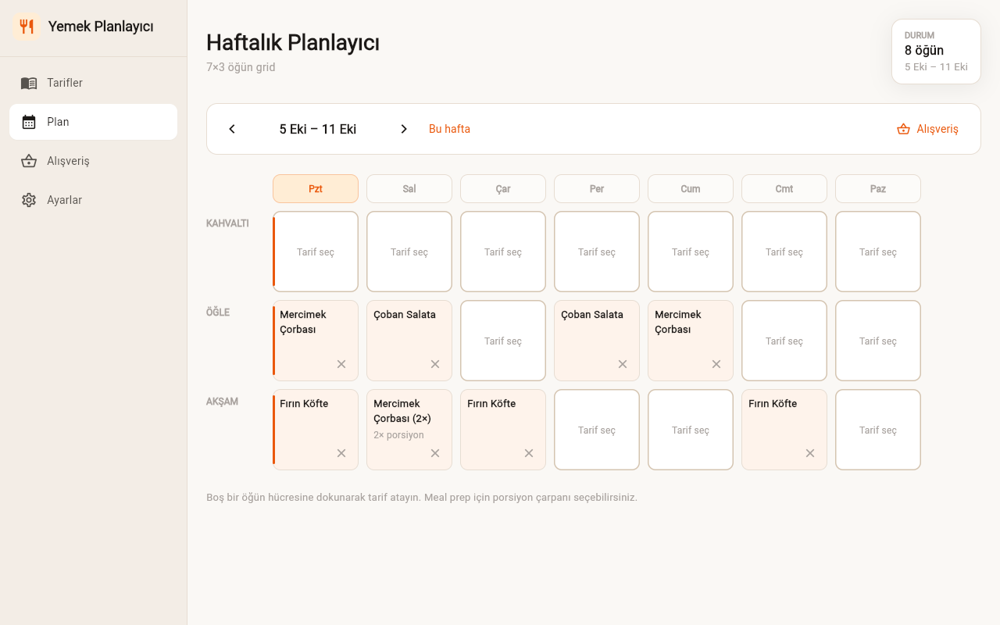

# Yemek Tarifi Yöneticisi ve Menü Planlayıcı

Kişisel tarif arşivi, haftalık menü planı ve plandan üretilen alışveriş listesi. Flutter ile yazılmıştır; Windows ve web üzerinde çalışır.



## Özellikler

- Tarif ekleme/düzenleme, arama, etiket ve süre filtresi (Tümü / <30 / <60 / >60 dk)
- Porsiyona göre malzeme ölçekleme; `1 1/2`, `½`, `2-3`, `yarım` gibi miktarlar anlaşılır
- Haftalık 7×3 öğün planı (kahvaltı / öğle / akşam) ve öğün başına porsiyon çarpanı
- Plandan birleşik alışveriş listesi; Türkçe birimler (g/kg, ml/l, adet, yk, sb, çk), panoya kopyalama
- Kiler: stoktaki malzemeleri alışveriş listesinde gizleme
- JSON ve Markdown tarif içe aktarma, tarifleri JSON olarak paylaşma
- Bozuk kayıt ekranı kilitlemez; ham veri `<anahtar>_bozuk_yedek` olarak saklanır
- Açık / koyu / sistem teması; dar pencerede alt gezinme çubuğu

## Çalıştırma

```powershell
.\run.ps1          # kaynaktan çalıştır (Windows > Chrome > Edge sırasıyla ilk uygun cihaz)
.\run.ps1 chrome   # cihazı elle seç
.\run.ps1 -Check   # testler
.\publish.ps1      # exe -> dist\yemek-tarifi-yoneticisi-ve-menu-planlayici\
```

Gereksinim: Flutter SDK (Dart 3.2+). Windows için Visual Studio C++ araçları ve Geliştirici Modu gerekir (`start ms-settings:developers`); Geliştirici Modu kapalıysa `.\run.ps1 chrome` ile web hedefi kullanılabilir.

## Kullanım

1. "Yeni tarif" ile tarif ekleyin; tarif sayfasında porsiyonu değiştirerek malzemeleri ölçekleyin.
2. Plan ekranında boş bir öğün hücresine dokunup tarif atayın, gerekirse porsiyon çarpanı seçin.
3. Alışveriş ekranı seçili haftanın planından listeyi üretir; "Stoktakileri gizle" kilerdekileri çıkarır.
4. Kiler, ana sayfadan (kenar çubuğundaki logo) veya Alışveriş ekranındaki "Kiler" bağlantısından açılır.

## Veri

Tüm veri `shared_preferences` içinde tutulur: Windows'ta kullanıcı uygulama verisi klasöründeki `shared_preferences.json`, web'de tarayıcı `localStorage`. Ağ erişimi, hesap ve analitik yoktur.
