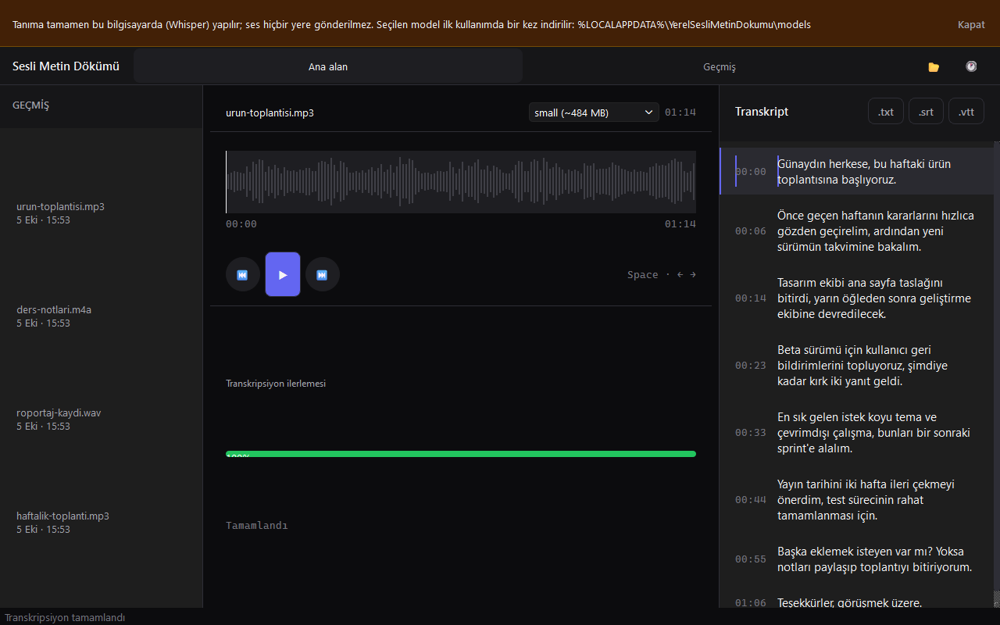

# Yerel Sesli Metin Dökümü Aracı

Ses dosyalarını bu bilgisayarda, CPU üzerinde faster-whisper ile metne çeviren PySide6 masaüstü uygulaması. Ses hiçbir sunucuya gönderilmez.



## Özellikler

- WAV, MP3, M4A, OGG, OPUS, FLAC (ve WebM/MP4 ses) dosyası açma; transkript Türkçe
- Sistemde ffmpeg gerekmez, ses PyAV ile çözülür
- Model seçimi: tiny / base / small (varsayılan) / medium
- Model ilk kullanımda bir kez indirilir, sonra uygulama çevrimdışı çalışır
- Segment zaman damgaları, oynatıcı ve dalga formu; cümleye tıklayınca o konuma atlama
- TXT / SRT / VTT dışa aktarma
- Ses dosyasını exe'nin üzerine bırakma veya "Birlikte aç" ile hemen dökme
- Son 50 işin geçmişi (transkript saklanmaz), dosya adıyla arama

## Çalıştırma

```powershell
.\run.ps1          # kaynaktan çalıştır
.\run.ps1 -Check   # testler
.\publish.ps1      # exe -> dist\yerel-sesli-metin-dokumu-araci\
```

Gereksinim: Python 3.11+. İlk model indirmesi için internet gerekir. Exe'yi taşırken tüm klasörü birlikte taşıyın.

## Kullanım

1. `Ctrl+O` ile ses dosyasını seçin; döküm hemen başlar.
2. Segmentler geldikçe Transkript listesinde zaman damgasıyla görünür.
3. .txt / .srt / .vtt düğmeleriyle dışa aktarın.

| Kısayol | İşlev |
| --- | --- |
| `Ctrl+O` | Ses dosyası aç |
| `Ctrl+H` | Geçmiş panelini aç / kapat |
| `Space` | Oynat / duraklat |
| `←` / `→` | 5 sn geri / ileri |

## Veri

Model ve ayarlar `%LOCALAPPDATA%\YerelSesliMetinDokumu\` altında, geçmiş `~/.yerel-sesli-metin-dokumu/history.db` dosyasında tutulur (yalnızca dosya adı, yol, süre ve tarih). Ağ erişimi yalnızca modeli Hugging Face'ten (`Systran/faster-whisper-<boyut>`) indirmek içindir.
