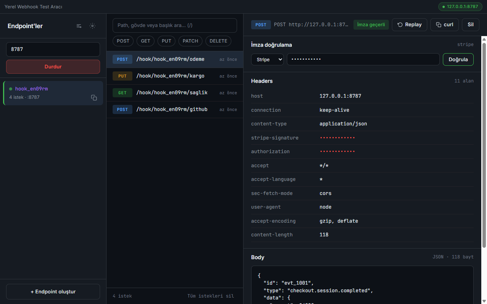

# HookYerel: Yerel Webhook Test Aracı

Webhook isteklerini internete açmadan `127.0.0.1` üzerinde yakalayan, mock yanıt veren ve imzaları doğrulayan Electron masaüstü uygulaması.



## Özellikler

- `http://127.0.0.1:<port>/hook/<slug>` adresinde yakalama; birden çok endpoint, açılışta otomatik başlar
- Canlı istek listesi, başlık/gövde detayı, JSON biçimlendirme ve arama
- Replay (yalnızca localhost) ve curl olarak kopyalama
- Endpoint başına mock yanıt kuralları (yöntem + path regex + durum + gövde)
- Stripe / GitHub / Shopify HMAC imza doğrulama
- Authorization/imza başlıklarını ve gizli gövde alanlarını maskeleme
- SQLite'ta saklama, saklama ve gövde boyutu sınırı, JSON günlük dışa aktarma

## Çalıştırma

```powershell
.\run.ps1          # kaynaktan çalıştır
.\run.ps1 -Check   # testler
.\run.ps1 -UiTest  # arayüz + e2e testleri (pencere açar)
.\publish.ps1      # exe -> dist\yerel-webhook-test-araci\
```

Gereksinim (kaynaktan): Node.js 22.12+. Varsayılan port 8787; doluysa sonraki 5 port denenir.

## Kullanım

Sol listedeki endpoint URL'ini kopyalayıp webhook gönderen servise verin. Gelen istekler listede belirir; detaydaki "İmza doğrulama" bölümünden preset ve secret ile imzayı doğrulayabilirsiniz. Kenar çubuğu başlığındaki "Mock kuralları" düğmesi kuralları açar; kural yoksa yanıt `200` olur.

| Kısayol | İşlev |
|---|---|
| `↑` / `↓` | İstekler arasında gezin |
| `r` | Seçili isteği yeniden gönder |
| `c` | Seçili isteği curl olarak kopyala |
| `f` veya `/` | Filtreye odaklan |
| `Ctrl+N` | Yeni endpoint |
| `Ctrl+L` | Aktif endpoint URL'ini kopyala |
| `?` | Kısayol yardımı |

## Veri

Veritabanı `%APPDATA%\yerel-webhook-test-araci\hookyerel.db` dosyasındadır; `HOOKYEREL_DATA_DIR` bu klasörü değiştirir. Sunucu yalnızca `127.0.0.1`'de dinler ve uygulama dışarıya bağlantı açmaz. Dışa aktarılan JSON hassas veri içerebilir.
