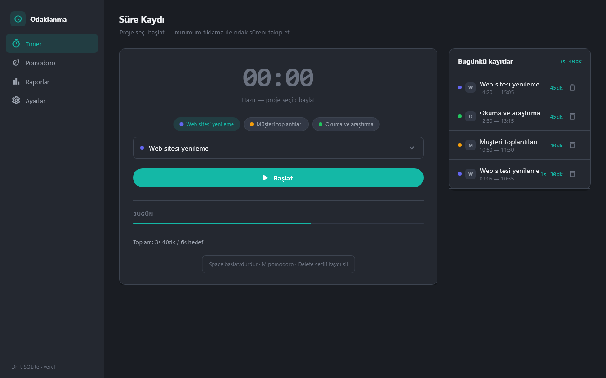

# Odaklanma: Zaman Takip ve Pomodoro

Proje bazlı süre kaydı, günlük rapor ve Pomodoro sayacı sunan Windows masaüstü uygulaması. Flutter ve yerel SQLite üzerine kuruludur.



## Özellikler

- Proje seçip başlatma / duraklatma / durdurma; duraklatılan süre kayda yazılmaz
- Günlük toplam, proje dağılımı ve günlük hedef çubuğu
- Pomodoro: odak, kısa mola ve 4 seansta bir uzun mola
- Sayaç duvar saatine göre işler; uygulama yeniden açılınca kaldığı yerden sürer
- Faz bitince sesli uyarı; günün domates sayısı saklanır
- Raporlar: günler arası gezinme, proje bazlı çubuk grafik, CSV dışa aktarma
- Ayarlar: süreler, günlük hedef, proje ekleme / yeniden adlandırma / renk / silme
- Bugünkü kayıt listesinden onaylı kayıt silme

## Çalıştırma

```powershell
.\run.ps1          # kaynaktan çalıştır
.\run.ps1 -Check   # testler
.\publish.ps1      # exe -> dist\zaman-takip-ve-pomodoro-araci\
```

Gereksinim: Flutter SDK (Dart 3.2+), Visual Studio "Desktop development with C++" ve Windows Geliştirici Modu (`start ms-settings:developers`). Yalnızca Windows hedefi vardır.

## Kullanım

| Kısayol | İşlem |
|---|---|
| `Boşluk` | Timer: başlat / durdur; Pomodoro: başlat / duraklat |
| `M` | Timer ↔ Pomodoro |
| `Delete` | Timer: seçili kaydı sil (onay istenir) |
| `←` / `→` | Raporlar: önceki / sonraki gün |

## Veri

Projeler ve süre kayıtları `Belgeler\time_tracking.sqlite`, CSV dosyaları `Belgeler\odaklanma-yyyy-MM-dd.csv` olarak yazılır; ayarlar ve sayaç durumu `shared_preferences.json` içindedir. Ağ erişimi, hesap ve analitik yoktur.
